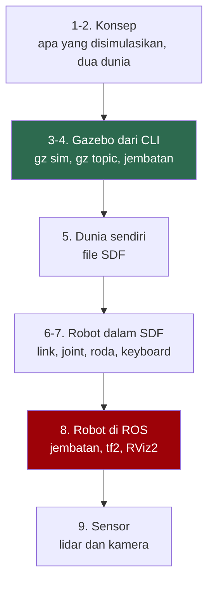
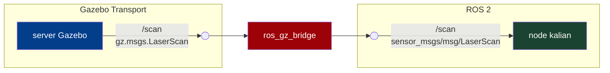
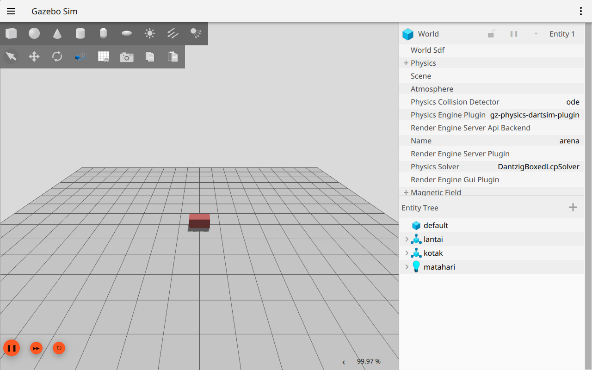
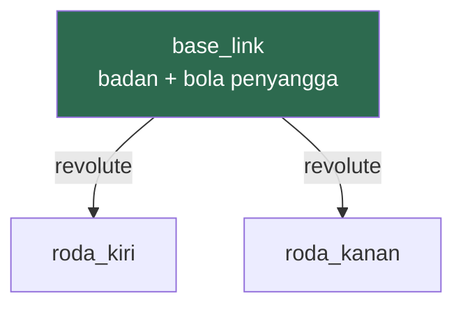
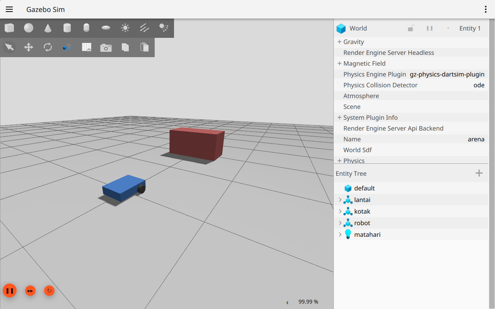
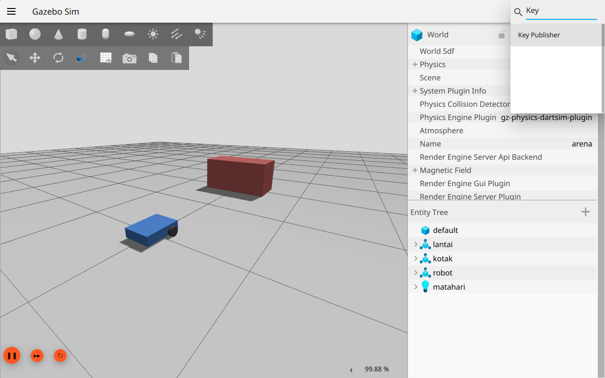
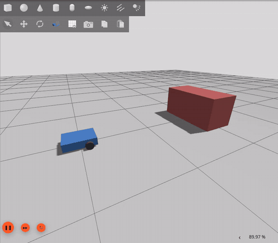
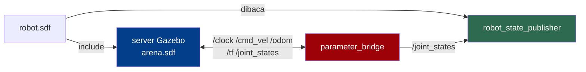
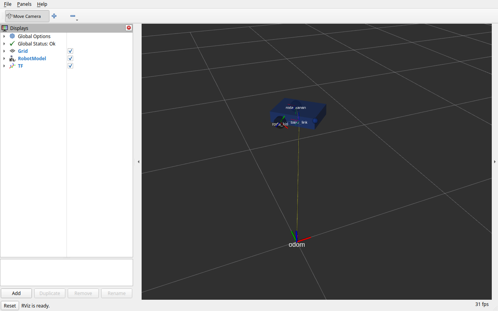
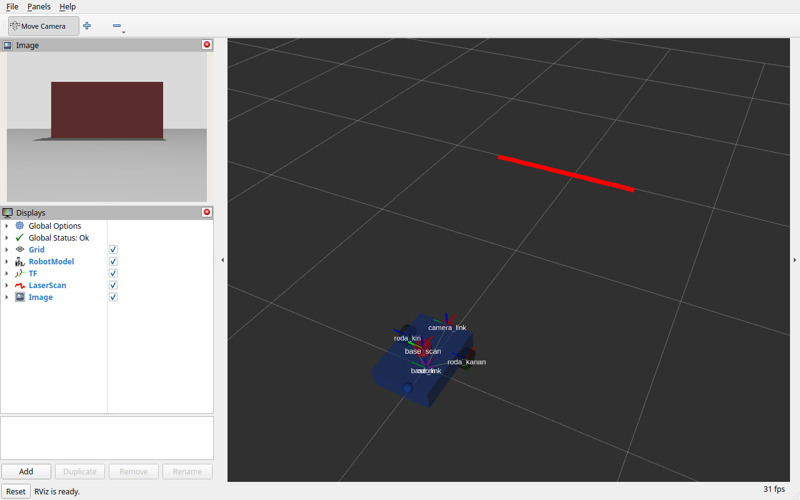

# Dasar Gazebo

Materi ini mengasumsikan kalian sudah menyelesaikan `instalasi-gazebo.md`, `../ROS 2/dasar-ros2.md`, dan `../ROS 2/lanjutan-ros2.md`. Dari materi lanjutan, yang paling banyak dipakai di sini adalah bagian 7 tentang waktu simulasi dan bagian 8 tentang tf2.

Semua contoh memakai workspace `~/ros2_ws` yang sama, dengan package baru bernama `latihan_gazebo`.

Di macOS, server dan jendela Gazebo selalu berjalan di dua terminal terpisah. Materi ini memang ditulis dengan cara itu sejak awal, jadi perintahnya sama untuk semua orang. Yang tidak bisa dijalankan di macOS cuma bagian 9, karena kamera dan lidar perlu rendering yang belum didukung Harmonic di macOS.

Kerjakan sambil mengetik. Setiap bagian menambah file ke package yang sama.

## Peta materi



Bagian 4 yang paling sering menyelamatkan kalian saat data dari simulasi tidak sampai ke ROS. Bagian 8 adalah tempat semua bagian sebelumnya bertemu.

## 1. Apa yang disimulasikan

Gazebo menghitung tiga hal untuk kalian.

| Yang dihitung | Contohnya | Kalau tidak ada simulasi |
|---|---|---|
| Fisika | Gaya, gesekan, tumbukan, roda yang selip | Robot asli dan lantai asli |
| Sensor | Jarak dari lidar, gambar dari kamera | Sensor asli dan drivernya |
| Tampilan | Jendela 3D tempat kalian melihat dunia | Mata kalian sendiri |

Yang penting: node ROS kalian tidak tahu sedang bicara dengan simulasi. Node yang membaca `/scan` dan menulis `/cmd_vel` bisa dipindah ke robot asli tanpa diubah, asalkan nama topic dan tipe pesannya sama. Itu inti dari seluruh materi ini.

Simulasi juga punya batas. Gesekan dan massa di simulasi cuma sebaik angka yang kalian tulis. Kode yang berjalan sempurna di Gazebo belum tentu berjalan di robot asli, tapi kode yang gagal di Gazebo hampir pasti gagal di robot asli.

## 2. Dua dunia yang terpisah

Gazebo bukan bagian dari ROS. Gazebo punya sistem pesan sendiri bernama Gazebo Transport, lengkap dengan topic, service, dan tipe pesannya sendiri. Bentuknya mirip ROS, tapi keduanya tidak saling melihat.



`ros2 topic list` tidak akan pernah menampilkan topic Gazebo, dan `gz topic -l` tidak akan pernah menampilkan topic ROS. Supaya data menyeberang, satu node khusus bernama `ros_gz_bridge` berlangganan di satu sisi dan menerbitkan ulang di sisi lain. Setiap topic yang ingin menyeberang harus didaftarkan ke jembatan satu per satu.

## 3. Gazebo dari terminal

Jalankan dunia contoh tanpa jendela. Flag `-s` berarti server saja, dan `-r` berarti langsung jalan. Tanpa `-r`, simulasi menunggu dalam keadaan pause.

Terminal 1:

```bash
gz sim -s -r shapes.sdf
```

Terminal 2, buka jendelanya:

```bash
gz sim -g
```

Jendela ini cuma penonton. Server tetap berjalan walaupun jendelanya ditutup, dan menutup server membuat jendelanya kosong. Di Linux, `gz sim shapes.sdf` menjalankan keduanya sekaligus, tapi memisahkan keduanya membuat kalian bisa menjalankan simulasi tanpa jendela kalau laptopnya berat.

Terminal 3, lihat isinya dari CLI:

```bash
gz topic -l
gz topic -e -t /clock -n 1
gz model --list
gz service -l
```

Perintahnya sengaja mirip dengan CLI ROS:

| ROS 2 | Gazebo | Gunanya |
|---|---|---|
| `ros2 topic list` | `gz topic -l` | Daftar topic |
| `ros2 topic echo /x` | `gz topic -e -t /x` | Lihat isi pesan |
| `ros2 topic info /x` | `gz topic -i -t /x` | Tipe pesan dan siapa yang menerbitkan |
| `ros2 service list` | `gz service -l` | Daftar service |
| tidak ada | `gz model --list` | Daftar benda di dunia |

`gz topic -e -t /clock` menampilkan tiga jam: `system` adalah jam dinding komputer, `real` adalah berapa lama server sudah menyala, dan `sim` adalah waktu di dalam simulasi. Waktu `sim` yang dikirim ke ROS lewat `/clock`.

Biarkan terminal 1 tetap berjalan untuk bagian berikutnya.

## 4. Jembatan

Daftarkan `/clock` ke jembatan:

```bash
ros2 run ros_gz_bridge parameter_bridge '/clock@rosgraph_msgs/msg/Clock[gz.msgs.Clock'
```

Di terminal lain:

```bash
ros2 topic echo /clock
```

Argumennya dibaca seperti ini:

```
/clock  @  rosgraph_msgs/msg/Clock  [  gz.msgs.Clock
nama       tipe ROS                 arah  tipe Gazebo
```

| Tanda | Arah |
|---|---|
| `[` | Gazebo ke ROS |
| `]` | ROS ke Gazebo |
| `@` | Dua arah |

Selalu bungkus argumennya dengan tanda kutip tunggal. Tanpa kutip, zsh menolak perintahnya karena membaca `[` sebagai pola nama file.

Pasangan tipe ROS dan tipe Gazebo tidak bebas. Jembatan cuma bisa menerjemahkan pasangan yang ada di daftar README `ros_gz_bridge`. Yang paling sering kalian pakai:

| ROS | Gazebo |
|---|---|
| `rosgraph_msgs/msg/Clock` | `gz.msgs.Clock` |
| `geometry_msgs/msg/Twist` | `gz.msgs.Twist` |
| `nav_msgs/msg/Odometry` | `gz.msgs.Odometry` |
| `tf2_msgs/msg/TFMessage` | `gz.msgs.Pose_V` |
| `sensor_msgs/msg/JointState` | `gz.msgs.Model` |
| `sensor_msgs/msg/LaserScan` | `gz.msgs.LaserScan` |
| `sensor_msgs/msg/Image` | `gz.msgs.Image` |
| `sensor_msgs/msg/CameraInfo` | `gz.msgs.CameraInfo` |

Kalau tipe Gazebo yang kalian tulis tidak cocok dengan tipe yang benar-benar diterbitkan di topic itu, jembatan tetap berjalan, mencetak `Creating GZ->ROS Bridge` seperti biasa, lalu tidak mengirim apa pun. Tidak ada pesan error. Kalau topic ROS kalian diam, bandingkan dulu tipe di jembatan dengan hasil `gz topic -i -t /nama_topic`.

Sekarang ROS punya jam simulasi. Seperti di bagian 7 `lanjutan-ros2.md`, node yang harus mengikuti jam ini perlu `use_sim_time` bernilai `true`. Mulai dari sini, setiap node yang memakai waktu, termasuk RViz2, kalian jalankan dengan parameter itu.

Matikan semua terminal dari bagian 3 dan 4.

## 5. Dunia sendiri

Dunia Gazebo ditulis dalam format SDF. Buat package-nya dulu:

```bash
cd ~/ros2_ws/src
ros2 pkg create --build-type ament_python --license Apache-2.0 latihan_gazebo
cd latihan_gazebo
mkdir sdf launch config
```

Buat file `~/ros2_ws/src/latihan_gazebo/sdf/arena.sdf`:

```xml
<?xml version="1.0"?>
<sdf version="1.10">
  <world name="arena">
    <physics name="1ms" type="ode">
      <max_step_size>0.001</max_step_size>
      <real_time_factor>1.0</real_time_factor>
    </physics>

    <plugin filename="gz-sim-physics-system" name="gz::sim::systems::Physics"/>
    <plugin filename="gz-sim-user-commands-system" name="gz::sim::systems::UserCommands"/>
    <plugin filename="gz-sim-scene-broadcaster-system" name="gz::sim::systems::SceneBroadcaster"/>
    <plugin filename="gz-sim-sensors-system" name="gz::sim::systems::Sensors">
      <render_engine>ogre2</render_engine>
    </plugin>

    <light type="directional" name="matahari">
      <cast_shadows>true</cast_shadows>
      <pose>0 0 10 0 0 0</pose>
      <diffuse>0.8 0.8 0.8 1</diffuse>
      <direction>-0.5 0.1 -0.9</direction>
    </light>

    <model name="lantai">
      <static>true</static>
      <link name="link">
        <collision name="collision">
          <geometry><plane><normal>0 0 1</normal><size>20 20</size></plane></geometry>
        </collision>
        <visual name="visual">
          <geometry><plane><normal>0 0 1</normal><size>20 20</size></plane></geometry>
          <material><diffuse>0.8 0.8 0.8 1</diffuse></material>
        </visual>
      </link>
    </model>

    <model name="kotak">
      <static>true</static>
      <pose>2 0 0.25 0 0 0</pose>
      <link name="link">
        <collision name="collision">
          <geometry><box><size>0.5 1 0.5</size></box></geometry>
        </collision>
        <visual name="visual">
          <geometry><box><size>0.5 1 0.5</size></box></geometry>
          <material><diffuse>0.8 0.2 0.2 1</diffuse></material>
        </visual>
      </link>
    </model>
  </world>
</sdf>
```

| Bagian | Gunanya |
|---|---|
| `<physics>` | Langkah fisika 1 ms. Makin kecil makin akurat, makin berat |
| `Physics` | Menghitung gaya dan tumbukan. Tanpa ini, tidak ada yang jatuh |
| `UserCommands` | Menerima perintah dari luar, misalnya menambah atau memindahkan benda dari jendela Gazebo |
| `SceneBroadcaster` | Mengirim isi dunia ke jendela Gazebo. Tanpa ini, jendelanya kosong |
| `Sensors` | Menghitung kamera dan lidar. Dipakai di bagian 9 |
| `<static>true</static>` | Benda tidak ikut dihitung fisikanya. Cocok untuk lantai dan tembok |

Sistem di atas tidak dipasang otomatis. Dunia yang lupa mencantumkan `Physics`, misalnya, tetap terbuka normal, tapi tidak ada satu benda pun yang bergerak.

Periksa dan jalankan dari folder `sdf`:

```bash
cd ~/ros2_ws/src/latihan_gazebo/sdf
gz sdf -k arena.sdf    # Valid.
gz sim -s -r arena.sdf
```

Buka `gz sim -g` di terminal lain. Harus ada lantai abu-abu dan satu kotak merah, dua meter di depan titik nol.



## 6. Robot dalam SDF

Robot juga ditulis dalam SDF. Kalau dunia dibungkus `<world>`, robot dibungkus `<model>`. Isi sebuah model ada dua jenis:

| Elemen | Artinya | Isinya |
|---|---|---|
| `link` | Satu bagian kaku robot | `visual` untuk tampilan, `collision` untuk tumbukan, `inertial` untuk massa, dan nanti `sensor` |
| `joint` | Sambungan antara dua link | `parent`, `child`, jenisnya, dan sumbu geraknya |

| Jenis joint | Gerakannya |
|---|---|
| `fixed` | Tidak bergerak. Sensor yang dibaut ke badan |
| `revolute` | Berputar pada satu sumbu. Roda dan lengan robot |
| `prismatic` | Bergeser lurus. Lift |

SDF sebenarnya punya jenis `continuous` untuk roda yang berputar tanpa batas, tapi mesin fisika di Harmonic belum mendukungnya. Gazebo cuma mencetak `Creating a FIXED joint instead`, lalu rodanya terkunci. Karena itu roda kita tulis sebagai `revolute` dengan batas sudut yang sangat besar.

Robot kita: badan kotak, dua roda penggerak di depan, satu bola di belakang sebagai penyangga.



Buat file `~/ros2_ws/src/latihan_gazebo/sdf/robot.sdf`:

```xml
<?xml version="1.0"?>
<sdf version="1.10">
  <model name="robot">

    <!-- Badan. Titik asalnya di lantai, tepat di bawah poros roda -->
    <link name="base_link">
      <inertial>
        <pose>0 0 0.075 0 0 0</pose>
        <mass>2.0</mass>
        <inertia>
          <ixx>0.0167</ixx>
          <iyy>0.0283</iyy>
          <izz>0.0417</izz>
        </inertia>
      </inertial>
      <visual name="badan_visual">
        <pose>0 0 0.075 0 0 0</pose>
        <geometry><box><size>0.4 0.3 0.1</size></box></geometry>
        <material><diffuse>0.1 0.3 0.8 1</diffuse></material>
      </visual>
      <collision name="badan_collision">
        <pose>0 0 0.075 0 0 0</pose>
        <geometry><box><size>0.4 0.3 0.1</size></box></geometry>
      </collision>

      <!-- Bola penyangga di belakang, licin sempurna -->
      <visual name="caster_visual">
        <pose>-0.15 0 0.025 0 0 0</pose>
        <geometry><sphere><radius>0.025</radius></sphere></geometry>
      </visual>
      <collision name="caster_collision">
        <pose>-0.15 0 0.025 0 0 0</pose>
        <geometry><sphere><radius>0.025</radius></sphere></geometry>
        <surface>
          <friction><ode><mu>0</mu><mu2>0</mu2></ode></friction>
        </surface>
      </collision>
    </link>

    <!-- Roda kiri -->
    <link name="roda_kiri">
      <pose>0.1 0.17 0.05 -1.5708 0 0</pose>
      <inertial>
        <mass>0.2</mass>
        <inertia>
          <ixx>0.00015</ixx>
          <iyy>0.00015</iyy>
          <izz>0.00025</izz>
        </inertia>
      </inertial>
      <visual name="visual">
        <geometry><cylinder><radius>0.05</radius><length>0.04</length></cylinder></geometry>
        <material><diffuse>0.1 0.1 0.1 1</diffuse></material>
      </visual>
      <collision name="collision">
        <geometry><cylinder><radius>0.05</radius><length>0.04</length></cylinder></geometry>
      </collision>
    </link>
    <joint name="roda_kiri_joint" type="revolute">
      <parent>base_link</parent>
      <child>roda_kiri</child>
      <axis>
        <xyz>0 0 1</xyz>
        <limit>
          <lower>-1e16</lower>
          <upper>1e16</upper>
        </limit>
      </axis>
    </joint>

    <!-- Roda kanan, sama persis kecuali posisinya -->
    <link name="roda_kanan">
      <pose>0.1 -0.17 0.05 -1.5708 0 0</pose>
      <inertial>
        <mass>0.2</mass>
        <inertia>
          <ixx>0.00015</ixx>
          <iyy>0.00015</iyy>
          <izz>0.00025</izz>
        </inertia>
      </inertial>
      <visual name="visual">
        <geometry><cylinder><radius>0.05</radius><length>0.04</length></cylinder></geometry>
        <material><diffuse>0.1 0.1 0.1 1</diffuse></material>
      </visual>
      <collision name="collision">
        <geometry><cylinder><radius>0.05</radius><length>0.04</length></cylinder></geometry>
      </collision>
    </link>
    <joint name="roda_kanan_joint" type="revolute">
      <parent>base_link</parent>
      <child>roda_kanan</child>
      <axis>
        <xyz>0 0 1</xyz>
        <limit>
          <lower>-1e16</lower>
          <upper>1e16</upper>
        </limit>
      </axis>
    </joint>

  </model>
</sdf>
```

| Bagian | Kenapa begitu |
|---|---|
| `<pose>` pada link | Posisi link terhadap titik asal model, ditulis `x y z roll pitch yaw` dalam meter dan radian |
| `<pose>` pada visual, collision, inertial | Posisi terhadap link-nya sendiri |
| Titik asal `base_link` di lantai | Badan digeser naik 0.075 m lewat `<pose>`. Posisi robot yang dilaporkan Gazebo, dan odometri nanti, adalah titik di lantai tepat di bawah poros roda |
| Bola penyangga di dalam `base_link` | Satu link boleh punya beberapa visual dan collision. Bola tidak bergerak terhadap badan, jadi tidak perlu link sendiri |
| `badan_visual` dan `badan_collision` | Di dalam satu link, nama visual dan collision tidak boleh ada yang sama. `gz sdf -k` menolaknya dengan `Non-unique names` |
| `mu` dan `mu2` nol pada penyangga | Bola licin sempurna, jadi tidak mengerem robot |
| `-1.5708` pada roda | Silinder di SDF berdiri tegak. Roda ditidurkan 90 derajat supaya porosnya menghadap ke samping |
| `<axis>` bernilai `0 0 1` | Sumbu putar ditulis dalam frame roda itu sendiri. Setelah ditidurkan, sumbu z roda menghadap ke kiri robot |
| `<limit>` sebesar `1e16` | Batas sudut yang tidak akan pernah tercapai, jadi roda praktis berputar bebas |
| `<inertial>` | Wajib untuk setiap link yang bergerak. Link tanpa `<inertial>` dianggap bermassa 1 kg dengan inersia 1, angka yang membuat roda kecil berperilaku seperti batu besar |

SDF tidak punya variabel atau rumus, jadi angka inersia kalian hitung sendiri dengan rumus benda pejal dari fisika dasar. Untuk kotak bermassa `m`, `ixx = m/12 (y² + z²)`, dan dua sumbu lain menyusul polanya. Untuk silinder, `ixx = iyy = m/12 (3r² + h²)` dan `izz = m r²/2`. Tidak harus sangat tepat, tapi harus masuk akal.

Sekarang masukkan robot ke dunia. Tambahkan blok ini ke `arena.sdf`, tepat sebelum baris `</world>`:

```xml
    <include>
      <uri>robot.sdf</uri>
    </include>
```

`<include>` memasukkan model dari file lain. Gazebo mencari file itu di folder tempat perintah dijalankan dan di folder-folder yang terdaftar di variabel lingkungan `GZ_SIM_RESOURCE_PATH`. Gazebo tidak mencarinya di folder file dunia. Jadi selalu jalankan dari folder `sdf`:

```bash
cd ~/ros2_ws/src/latihan_gazebo/sdf
gz sdf -k robot.sdf    # Valid.
gz sdf -k arena.sdf    # Valid.
gz sim -s -r arena.sdf
```

Kalau dijalankan dari folder lain, server langsung berhenti dengan pesan `Unable to find uri[robot.sdf]`.

Buka `gz sim -g` di terminal lain. Robot biru berdiri di titik nol, menghadap kotak merah. Di terminal ketiga:

```bash
gz model -m robot
```

Gazebo mencetak tiga link, `base_link`, `roda_kiri`, dan `roda_kanan`, beserta dua joint roda. Robotnya belum bisa bergerak, karena belum ada yang memutar rodanya.



Sudut kamera di gambar ini digeser supaya robotnya terlihat jelas. Di jendela kalian, putar kamera dengan menyeret tombol kiri mouse dan perbesar dengan scroll.

## 7. Menggerakkan robot dengan keyboard

Roda diputar oleh sistem `DiffDrive`. Sistem ini menerima perintah kecepatan maju dan putar, lalu menghitung sendiri kecepatan masing-masing roda.

Tambahkan blok ini ke `robot.sdf`, tepat sebelum baris `</model>`:

```xml
    <!-- Gazebo menggerakkan roda dari perintah di /cmd_vel -->
    <plugin filename="gz-sim-diff-drive-system" name="gz::sim::systems::DiffDrive">
      <left_joint>roda_kiri_joint</left_joint>
      <right_joint>roda_kanan_joint</right_joint>
      <wheel_separation>0.34</wheel_separation>
      <wheel_radius>0.05</wheel_radius>
      <topic>/cmd_vel</topic>
      <odom_topic>/odom</odom_topic>
      <tf_topic>/tf</tf_topic>
      <frame_id>odom</frame_id>
      <child_frame_id>base_link</child_frame_id>
      <odom_publish_frequency>30</odom_publish_frequency>
    </plugin>
```

| Bagian | Kenapa begitu |
|---|---|
| `left_joint`, `right_joint` | Joint roda yang diputar |
| `wheel_separation`, `wheel_radius` | Jarak antar roda dan jari-jarinya. Harus sama dengan ukuran di link, karena dipakai untuk menghitung kecepatan roda dan odometri |
| `<topic>` | Perintah kecepatan dibaca dari `/cmd_vel`, bertipe `gz.msgs.Twist` |
| `odom_topic`, `tf_topic` | Hasil odometri, yaitu posisi robot menurut putaran roda |
| `frame_id`, `child_frame_id` | Nama frame di pesan odometri, dipakai di bagian 8 |

Tanpa tulisan `<topic>`, DiffDrive mendengarkan `/model/robot/cmd_vel`. Kita tulis eksplisit supaya namanya sama dengan nama yang dipakai di ROS.

Matikan server dengan Ctrl-C, jalankan lagi, lalu coba dari terminal:

```bash
gz topic -t /cmd_vel -m gz.msgs.Twist -p 'linear: {x: 0.3}'
gz topic -t /cmd_vel -m gz.msgs.Twist -p 'linear: {x: 0.0}'
```

Perintah pertama membuat robot maju, perintah kedua menghentikannya. DiffDrive terus memakai perintah terakhir yang diterimanya, jadi robot tidak berhenti sendiri.

### Tombol panah

Jendela Gazebo punya plugin bernama Key Publisher. Setiap tombol yang ditekan di jendela dikirimnya sebagai angka bertipe `gz.msgs.Int32` ke topic `/keyboard/keypress`. Angka itu belum berarti apa-apa bagi robot. Yang menerjemahkannya menjadi perintah kecepatan adalah sistem `TriggeredPublisher`: setiap kali pesan tertentu datang di satu topic, sistem ini mengirim pesan yang sudah kita tentukan ke topic lain.

Tambahkan blok ini ke `arena.sdf`, tepat sebelum baris `</world>`:

```xml
    <!-- Tombol panah menjadi perintah kecepatan -->
    <plugin filename="gz-sim-triggered-publisher-system" name="gz::sim::systems::TriggeredPublisher">
      <input type="gz.msgs.Int32" topic="/keyboard/keypress">
        <match field="data">16777235</match>
      </input>
      <output type="gz.msgs.Twist" topic="/cmd_vel">linear: {x: 0.5}, angular: {z: 0.0}</output>
    </plugin>
    <plugin filename="gz-sim-triggered-publisher-system" name="gz::sim::systems::TriggeredPublisher">
      <input type="gz.msgs.Int32" topic="/keyboard/keypress">
        <match field="data">16777237</match>
      </input>
      <output type="gz.msgs.Twist" topic="/cmd_vel">linear: {x: -0.5}, angular: {z: 0.0}</output>
    </plugin>
    <plugin filename="gz-sim-triggered-publisher-system" name="gz::sim::systems::TriggeredPublisher">
      <input type="gz.msgs.Int32" topic="/keyboard/keypress">
        <match field="data">16777234</match>
      </input>
      <output type="gz.msgs.Twist" topic="/cmd_vel">linear: {x: 0.0}, angular: {z: 1.0}</output>
    </plugin>
    <plugin filename="gz-sim-triggered-publisher-system" name="gz::sim::systems::TriggeredPublisher">
      <input type="gz.msgs.Int32" topic="/keyboard/keypress">
        <match field="data">16777236</match>
      </input>
      <output type="gz.msgs.Twist" topic="/cmd_vel">linear: {x: 0.0}, angular: {z: -1.0}</output>
    </plugin>
    <plugin filename="gz-sim-triggered-publisher-system" name="gz::sim::systems::TriggeredPublisher">
      <input type="gz.msgs.Int32" topic="/keyboard/keypress">
        <match field="data">75</match>
      </input>
      <output type="gz.msgs.Twist" topic="/cmd_vel">linear: {x: 0.0}, angular: {z: 0.0}</output>
    </plugin>
```

| Tombol | Kode | Perintah |
|---|---|---|
| Panah atas | 16777235 | Maju 0.5 m/s |
| Panah bawah | 16777237 | Mundur 0.5 m/s |
| Panah kiri | 16777234 | Berputar ke kiri 1 rad/s |
| Panah kanan | 16777236 | Berputar ke kanan 1 rad/s |
| `K` | 75 | Berhenti |

Kode tombol berasal dari Qt, pustaka jendela yang dipakai Gazebo. Huruf memakai kode ASCII huruf besarnya, misalnya `K` adalah 75. Untuk melihat kode tombol lain, jalankan `gz topic -e -t /keyboard/keypress` lalu tekan tombolnya di jendela Gazebo.

Tidak semua tombol bisa dipakai. Spasi adalah tombol pause milik Gazebo sendiri, jadi menekannya menghentikan seluruh simulasi, bukan cuma robotnya. Beberapa huruf, misalnya `S` dan `X`, juga ditangkap Gazebo dan tidak pernah sampai ke `/keyboard/keypress`. Sebelum memetakan tombol baru, pastikan kodenya muncul di `gz topic -e`.

Blok ini ditaruh di dunia, bukan di robot, karena pemetaan tombol adalah urusan cara kalian bermain, bukan bagian dari robotnya.

Jalankan ulang server dari folder `sdf`, lalu buka `gz sim -g`. Di jendela Gazebo:

1. Klik ikon tiga titik di pojok kanan atas, ketik `Key Publisher` di kotak pencarian, lalu klik hasilnya.
2. Klik sekali di area 3D supaya fokus keyboard ada di jendela Gazebo.
3. Tekan panah atas. Robot maju. Tekan `K` untuk berhenti.



Key Publisher harus ditambahkan lagi setiap kali jendela dibuka ulang.

Hasilnya seperti ini: panah atas sampai menabrak kotak, `K`, panah kiri, `K`, panah atas, `K`.



Titik kuning di lantai adalah penanda kamera Gazebo, muncul di tempat terakhir kalian mengklik. Bukan bagian dari dunia.

### Odometri bisa berbohong

Kendarai robot lurus ke kotak merah sampai menabrak, dan jangan tekan `K`. Bandingkan dua posisi ini:

```bash
gz model -m robot -p          # posisi sebenarnya, dari Gazebo
gz topic -e -t /odom -n 1     # posisi menurut putaran roda, lihat bagian position
```

Posisi dari Gazebo berhenti di sekitar `x` 1.55, tepat saat bagian depan robot menyentuh kotak. Posisi dari `/odom` terus bertambah, karena roda masih berputar di tempat dan odometri cuma menghitung putaran roda. Inilah kenapa REP 105 di bagian 8 `lanjutan-ros2.md` menyebut frame `odom` "mulus tapi melenceng pelan-pelan". Robot yang cuma percaya odometri tidak tahu dirinya sedang menabrak.

## 8. Robot di ROS

Sampai di sini ROS belum dipakai sama sekali. Semua yang terjadi di bagian 6 dan 7 berlangsung di dalam Gazebo. Sekarang kita sambungkan.

Pertama, posisi roda perlu dilaporkan. Tambahkan blok ini ke `robot.sdf`, tepat sebelum baris `</model>`:

```xml
    <!-- Gazebo melaporkan posisi sendi roda -->
    <plugin filename="gz-sim-joint-state-publisher-system" name="gz::sim::systems::JointStatePublisher">
      <topic>/joint_states</topic>
    </plugin>
```

Di sisi ROS, deskripsi robot dibaca oleh `robot_state_publisher`. Node ini menerbitkan dua hal: deskripsi robot itu sendiri di `/robot_description`, dan posisi setiap link di tf2. Link yang disambung joint `fixed` diterbitkan di `/tf_static`. Link yang bisa bergerak, seperti roda, cuma bisa diterbitkan kalau ada yang melaporkan sudut joint-nya ke topic `/joint_states`. Pada robot asli, yang melaporkan adalah driver motor. Di sini, `JointStatePublisher` di Gazebo yang melakukannya.

`robot_state_publisher` aslinya membaca format URDF, format deskripsi robot milik ROS. Paket `sdformat_urdf` yang terpasang bersama `ros-jazzy-ros-gz` membuatnya bisa membaca file SDF juga, jadi `robot.sdf` yang sama dipakai oleh Gazebo dan oleh ROS.

Topic-topic Gazebo didaftarkan ke jembatan lewat file. Buat file `~/ros2_ws/src/latihan_gazebo/config/bridge.yaml`:

```yaml
- ros_topic_name: /clock
  gz_topic_name: /clock
  ros_type_name: rosgraph_msgs/msg/Clock
  gz_type_name: gz.msgs.Clock
  direction: GZ_TO_ROS

- ros_topic_name: /cmd_vel
  gz_topic_name: /cmd_vel
  ros_type_name: geometry_msgs/msg/Twist
  gz_type_name: gz.msgs.Twist
  direction: ROS_TO_GZ

- ros_topic_name: /odom
  gz_topic_name: /odom
  ros_type_name: nav_msgs/msg/Odometry
  gz_type_name: gz.msgs.Odometry
  direction: GZ_TO_ROS

- ros_topic_name: /tf
  gz_topic_name: /tf
  ros_type_name: tf2_msgs/msg/TFMessage
  gz_type_name: gz.msgs.Pose_V
  direction: GZ_TO_ROS

- ros_topic_name: /joint_states
  gz_topic_name: /joint_states
  ros_type_name: sensor_msgs/msg/JointState
  gz_type_name: gz.msgs.Model
  direction: GZ_TO_ROS
```

Isinya sama dengan argumen di bagian 4, cuma ditulis per baris. `direction` menggantikan tanda `[`, `]`, dan `@`.

Sekarang satukan semuanya dalam launch file. Buat file `~/ros2_ws/src/latihan_gazebo/launch/sim.launch.py`:

```python
import os

from ament_index_python.packages import get_package_share_directory
from launch import LaunchDescription
from launch.actions import AppendEnvironmentVariable, IncludeLaunchDescription
from launch.launch_description_sources import PythonLaunchDescriptionSource
from launch_ros.actions import Node


def generate_launch_description():
    pkg = get_package_share_directory('latihan_gazebo')
    sdf_dir = os.path.join(pkg, 'sdf')
    with open(os.path.join(sdf_dir, 'robot.sdf')) as f:
        robot_description = f.read()

    gz_server = IncludeLaunchDescription(
        PythonLaunchDescriptionSource(os.path.join(
            get_package_share_directory('ros_gz_sim'), 'launch', 'gz_sim.launch.py')),
        launch_arguments={'gz_args': f'-s -r {os.path.join(sdf_dir, "arena.sdf")}'}.items(),
    )

    return LaunchDescription([
        AppendEnvironmentVariable('GZ_SIM_RESOURCE_PATH', sdf_dir),
        gz_server,
        Node(
            package='robot_state_publisher',
            executable='robot_state_publisher',
            parameters=[{'robot_description': robot_description, 'use_sim_time': True}],
        ),
        Node(
            package='ros_gz_bridge',
            executable='parameter_bridge',
            parameters=[{'config_file': os.path.join(pkg, 'config', 'bridge.yaml')}],
        ),
    ])
```



| Baris | Kenapa begitu |
|---|---|
| `robot_description = f.read()` | Isi `robot.sdf` diberikan apa adanya ke `robot_state_publisher`. Robotnya sendiri sudah masuk ke dunia lewat `<include>`, jadi tidak perlu dimasukkan lagi |
| `AppendEnvironmentVariable` | Menambahkan folder `sdf` ke `GZ_SIM_RESOURCE_PATH`, supaya `<include>` menemukan `robot.sdf` dari folder mana pun launch dijalankan |
| `gz_sim.launch.py` dengan `-s -r` | Server saja, langsung jalan. Jendelanya kalian buka sendiri dengan `gz sim -g` |
| `use_sim_time: True` | `robot_state_publisher` mencap transform dengan jam simulasi, sama dengan jam yang dipakai `/odom` dan `/tf` dari Gazebo |
| `config_file` | Jembatan membaca daftar topic dari `bridge.yaml` |

Daftarkan folder-folder baru di `setup.py`, di bagian atas file dan di `data_files`:

```python
import os
from glob import glob

    data_files=[
        ('share/ament_index/resource_index/packages',
            ['resource/' + package_name]),
        ('share/' + package_name, ['package.xml']),
        (os.path.join('share', package_name, 'launch'), glob('launch/*.launch.py')),
        (os.path.join('share', package_name, 'sdf'), glob('sdf/*')),
        (os.path.join('share', package_name, 'config'), glob('config/*')),
    ],
```

Lalu dependensinya di `package.xml`, sebelum baris `<test_depend>` yang pertama:

```xml
  <exec_depend>ros_gz_sim</exec_depend>
  <exec_depend>ros_gz_bridge</exec_depend>
  <exec_depend>robot_state_publisher</exec_depend>
  <exec_depend>sdformat_urdf</exec_depend>
```

Build dan jalankan:

```bash
cd ~/ros2_ws && colcon build --symlink-install && source install/setup.bash
ros2 launch latihan_gazebo sim.launch.py
```

`robot_state_publisher` mencetak peringatan `The root link base_link has an inertia specified in the URDF, but KDL does not support a root link with an inertia`. Peringatan ini bisa diabaikan. Node ini cuma butuh posisi link, bukan massanya.

Buka jendelanya dengan `gz sim -g` dan tambahkan Key Publisher seperti di bagian 7. Tombol panah tetap jalan. Karena `/cmd_vel` sekarang juga dijembatani dari ROS ke Gazebo, node ROS mana pun yang menerbitkan `/cmd_vel` bisa mengendalikan robot:

```bash
ros2 topic pub --times 5 -r 5 /cmd_vel geometry_msgs/msg/Twist '{angular: {z: 1.0}}'
```

Robot berputar ke kiri, lalu terus berputar walaupun perintahnya berhenti dikirim, sama seperti di bagian 7. Tekan `K` di jendela Gazebo untuk menghentikannya.

Lihat dari sisi ROS:

```bash
ros2 topic list
ros2 topic info /robot_description --verbose
ros2 topic echo /odom --field pose.pose.position
```

Durability `/robot_description` adalah `TRANSIENT_LOCAL`, sama seperti `/tf_static` di bagian 9 `lanjutan-ros2.md`. Node yang menyala belakangan, termasuk RViz2, tetap menerima deskripsinya.

Jalankan `rviz2 --ros-args -p use_sim_time:=true`, lalu:

1. Ganti Fixed Frame di panel kiri menjadi `odom`.
2. Klik Add, pilih RobotModel. Di dalamnya, isi Description Topic dengan `/robot_description`.
3. Klik Add, pilih TF.

Robot lengkap dengan rodanya muncul, dan bergerak saat kalian mengendarainya. Pohon frame-nya `odom`, `base_link`, lalu kedua roda, sesuai konvensi REP 105 di bagian 8 `lanjutan-ros2.md`. Transform `odom` ke `base_link` datang dari DiffDrive lewat `/tf`, sedangkan transform ke roda datang dari `robot_state_publisher` yang membaca `/joint_states`.



Gambar ini diambil setelah robot dikendarai sebentar, jadi `base_link` sudah tidak berada di atas `odom`. Garis kuning menunjukkan hubungan antar frame. RobotModel di gambar dibuat transparan lewat Alpha 0.5 supaya frame di dalamnya terlihat.

## 9. Sensor

Lewati bagian ini kalau kalian di macOS.

Tambahkan blok ini ke `robot.sdf`, tepat sebelum baris `</model>`:

```xml
    <!-- Lidar di atas badan -->
    <link name="base_scan">
      <pose>0 0 0.145 0 0 0</pose>
      <inertial>
        <mass>0.1</mass>
        <inertia>
          <ixx>0.00005</ixx>
          <iyy>0.00005</iyy>
          <izz>0.00008</izz>
        </inertia>
      </inertial>
      <visual name="visual">
        <geometry><cylinder><radius>0.04</radius><length>0.04</length></cylinder></geometry>
      </visual>
      <sensor name="lidar" type="gpu_lidar">
        <topic>/scan</topic>
        <gz_frame_id>base_scan</gz_frame_id>
        <update_rate>10</update_rate>
        <always_on>true</always_on>
        <visualize>true</visualize>
        <lidar>
          <scan>
            <horizontal>
              <samples>360</samples>
              <min_angle>-3.14159</min_angle>
              <max_angle>3.14159</max_angle>
            </horizontal>
          </scan>
          <range>
            <min>0.12</min>
            <max>8.0</max>
          </range>
        </lidar>
      </sensor>
    </link>
    <joint name="base_scan_joint" type="fixed">
      <parent>base_link</parent>
      <child>base_scan</child>
    </joint>

    <!-- Kamera menghadap ke depan -->
    <link name="camera_link">
      <pose>0.21 0 0.1 0 0 0</pose>
      <inertial>
        <mass>0.05</mass>
        <inertia>
          <ixx>0.00002</ixx>
          <iyy>0.00001</iyy>
          <izz>0.00002</izz>
        </inertia>
      </inertial>
      <visual name="visual">
        <geometry><box><size>0.02 0.06 0.03</size></box></geometry>
      </visual>
      <sensor name="kamera" type="camera">
        <topic>/camera/image</topic>
        <gz_frame_id>camera_link</gz_frame_id>
        <update_rate>15</update_rate>
        <always_on>true</always_on>
        <camera>
          <horizontal_fov>1.05</horizontal_fov>
          <image>
            <width>640</width>
            <height>480</height>
          </image>
          <clip>
            <near>0.05</near>
            <far>20</far>
          </clip>
        </camera>
      </sensor>
    </link>
    <joint name="camera_joint" type="fixed">
      <parent>base_link</parent>
      <child>camera_link</child>
    </joint>
```

Lalu tambahkan di akhir `bridge.yaml`:

```yaml
- ros_topic_name: /scan
  gz_topic_name: /scan
  ros_type_name: sensor_msgs/msg/LaserScan
  gz_type_name: gz.msgs.LaserScan
  direction: GZ_TO_ROS

- ros_topic_name: /camera/image
  gz_topic_name: /camera/image
  ros_type_name: sensor_msgs/msg/Image
  gz_type_name: gz.msgs.Image
  direction: GZ_TO_ROS

- ros_topic_name: /camera/camera_info
  gz_topic_name: /camera/camera_info
  ros_type_name: sensor_msgs/msg/CameraInfo
  gz_type_name: gz.msgs.CameraInfo
  direction: GZ_TO_ROS
```

| Bagian | Kenapa begitu |
|---|---|
| Link `base_scan` dan `camera_link` dengan joint `fixed` | Sensor ditaruh di link sendiri, supaya `robot_state_publisher` menerbitkan posisinya di `/tf_static` |
| `<inertial>` kecil pada link sensor | Tanpa ini, link dianggap bermassa 1 kg. Lidar seberat itu di atas badan 2 kg mengubah cara robot bergerak |
| `type="gpu_lidar"` | Lidar di Harmonic dihitung dengan GPU. Tipe `lidar` biasa diterima tanpa error, tapi tidak pernah mengirim data |
| `<gz_frame_id>` | Nama frame yang ditulis di header pesan. Lihat penjelasan di bawah |
| `samples` 360 dari `-3.14159` sampai `3.14159` | Satu titik per derajat, satu putaran penuh |
| `range` 0.12 sampai 8 | Jarak di luar rentang ini dilaporkan sebagai `inf` |
| `horizontal_fov` 1.05 | Sudut pandang kamera sekitar 60 derajat |

Tanpa `<gz_frame_id>`, Gazebo mengisi header pesan lidar dengan nama lengkap sensornya, yaitu `robot::base_scan::lidar`. Frame dengan nama itu tidak ada di pohon tf2, sehingga RViz2 menolak menampilkannya. `<gz_frame_id>` memaksa header berisi `base_scan`, nama link yang memang diterbitkan `robot_state_publisher`.

Saat dijalankan, Gazebo mencetak peringatan kuning `XML Element[gz_frame_id], child of element[sensor], not defined in SDF`. Peringatan ini bisa diabaikan. Elemennya tetap dibaca.

Jalankan ulang launch file dan `gz sim -g` seperti di bagian 8. Karena memakai `--symlink-install`, tidak perlu build ulang. Build ulang baru perlu kalau kalian menambah file baru.

```bash
ros2 topic echo /scan --field header.frame_id
ros2 topic hz /scan
ros2 topic echo /camera/camera_info --field header.frame_id
```

Frame-nya `base_scan` dan `camera_link`, dan `/scan` datang sekitar 10 kali per detik.

Di RViz2 dengan Fixed Frame `odom`, tambahkan:

1. LaserScan dengan Topic `/scan`. Titik-titik muncul membentuk sisi depan kotak.
2. Image dengan Topic `/camera/image`. Panel baru muncul berisi pandangan kamera.



Kotak merah berada 2 meter dari titik nol dan tebalnya 0.5 meter, jadi sisi depannya di `x` 1.75. Selama robot belum bergerak, sinar lidar yang menghadap lurus ke depan harus membaca 1.75. Kendarai robot dengan tombol panah dan lihat titik-titiknya bergeser.

## 10. Kesalahan yang paling sering terjadi

| Yang terlihat | Penyebab | Bagian |
|---|---|---|
| Topic ROS ada, tapi diam | Topic belum didaftarkan ke jembatan, atau tipe Gazebo di jembatan salah | 4 |
| Jendela Gazebo kosong, padahal server jalan | `SceneBroadcaster` tidak ada di file dunia | 5 |
| Server berhenti dengan `Unable to find uri[robot.sdf]` | Perintah tidak dijalankan dari folder `sdf`, atau `GZ_SIM_RESOURCE_PATH` tidak berisi folder itu | 6, 8 |
| `gz sdf -k` menolak dengan `Non-unique names` | Visual dan collision dalam satu link punya nama yang sama | 6 |
| Roda tidak berputar, log berisi `Creating a FIXED joint instead` | Joint roda bertipe `continuous`. Pakai `revolute` dengan batas besar | 6 |
| Robot bergetar, melompat, atau tenggelam ke lantai | Link tanpa `<inertial>`, atau angka inersia asal | 6 |
| Robot tidak bergerak sama sekali | Server dijalankan tanpa `-r` dan simulasi dalam keadaan pause, atau `<topic>` di DiffDrive tidak sama dengan topic perintahnya | 3, 7 |
| Tombol panah tidak berbuat apa-apa | Key Publisher belum ditambahkan, atau fokus keyboard tidak di area 3D | 7 |
| Semua berhenti, termasuk jam simulasi, setelah menekan spasi | Spasi adalah tombol pause Gazebo. Tekan tombol play di pojok kiri bawah | 7 |
| `/odom` terus bertambah padahal robot diam menabrak | Roda selip. Odometri memang begitu | 7 |
| Roda tidak muncul di RViz2 | `/joint_states` tidak ada, karena `JointStatePublisher` belum dipasang atau belum didaftarkan ke jembatan | 8 |
| RViz2 berkedip, peringatan soal transform dari masa depan atau masa lalu | Sebagian node memakai jam dinding, sebagian jam simulasi. Pasang `use_sim_time` di semua node, termasuk RViz2 | 4, 8 |
| `/scan` ada tapi RViz2 menolak menampilkannya | `frame_id` di header tidak ada di pohon tf2, biasanya karena `<gz_frame_id>` lupa ditulis | 9 |
| `/scan` tidak pernah muncul di `gz topic -l` | Tipe sensor `lidar` bukan `gpu_lidar`, atau sistem `Sensors` tidak ada di file dunia | 5, 9 |

## Bacaan lanjutan

Materi ini disusun untuk urutan perkuliahan kita. Penjelasan resmi yang lebih panjang:

| Topik | Halaman resmi |
|---|---|
| Gazebo dan ROS 2 | [ROS 2 integration overview](https://gazebosim.org/docs/harmonic/ros2_integration/) |
| Membuat robot di SDF | [Building your own robot](https://gazebosim.org/docs/harmonic/building_robot/) |
| Menggerakkan robot dengan keyboard | [Moving the robot](https://gazebosim.org/docs/harmonic/moving_robot/) |
| Jembatan dan daftar pasangan tipe | [ros_gz_bridge README](https://github.com/gazebosim/ros_gz/tree/jazzy/ros_gz_bridge) |
| Sensor | [Sensors](https://gazebosim.org/docs/harmonic/sensors/) |
| Dunia SDF | [SDF worlds](https://gazebosim.org/docs/harmonic/sdf_worlds/) |
| Format SDF lengkap | [SDFormat specification](http://sdformat.org/spec) |

## Catatan teknis

Semua diagram di materi ini, yaitu peta materi, diagram dua dunia di bagian 2, pohon link di bagian 6, dan alur launch file di bagian 8, ditulis dengan sintaks mermaid dan khusus dibuat untuk mata kuliah ini. Diagram mermaid tampil sebagai gambar kalau file dibuka lewat GitHub, GitLab, Obsidian, atau pratinjau markdown di VS Code. Di penampil markdown sederhana, isinya tampil sebagai teks dan masih terbaca.

Contoh keluaran di materi ini diambil dari ROS 2 Jazzy dan Gazebo Harmonic 8.15 di Ubuntu 24.04. Angka posisi dan stempel waktu di laptop kalian akan sedikit berbeda.
