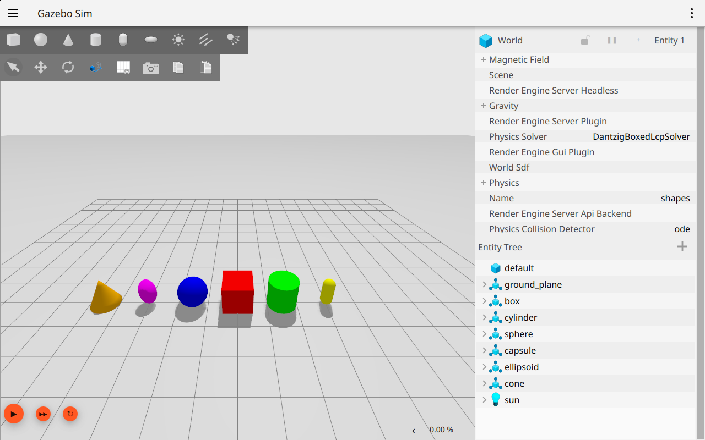

# Panduan Instalasi Gazebo Harmonic

Panduan ini lanjutan dari `../ROS 2/instalasi-ros2.md`. Selesaikan dulu panduan itu sampai bagian "Instalasi dianggap selesai kalau" lolos semua.

Kerjakan sebelum pertemuan Gazebo pertama. Kalau ada yang gagal, catat pesan errornya persis seperti yang muncul di layar.

## Kenapa lewat paket ROS

Gazebo bisa dipasang sendiri dari repositori Gazebo, tapi kita tidak melakukannya. Jazzy sudah membawa Gazebo Harmonic di dalam paketnya sendiri, disebut paket vendor, dan versinya dipastikan cocok dengan jembatan ROS ke Gazebo.

Satu paket memasang semuanya: `ros-jazzy-ros-gz`. Isinya Gazebo Harmonic lengkap dengan jendelanya, jembatan `ros_gz_bridge`, `robot_state_publisher`, dan `sdformat_urdf` yang membuat ROS bisa membaca file robot SDF.

Jangan pasang paket `gz-harmonic` dari repositori Gazebo di samping paket ini. Hasilnya dua salinan Gazebo di satu laptop, dan kalian tidak tahu yang mana yang sedang berjalan.

## Pilih jalur

Ikuti jalur yang sama dengan instalasi ROS 2 kalian.

| Jalur ROS 2 kalian | Bagian |
|---|---|
| Ubuntu 24.04 langsung, WSL2, atau Distrobox | [Bagian 1](#bagian-1-ubuntu-wsl2-dan-distrobox) |
| macOS dengan pixi atau micromamba | [Bagian 2](#bagian-2-macos) |
| NixOS | [Bagian 3](#bagian-3-nixos) |
| RHEL, Rocky, Alma | ROS 2 di host tidak membawa Gazebo. Buat Distrobox seperti `../ROS 2/instalasi-ros2.md` bagian 4.1, lalu ikuti [Bagian 1](#bagian-1-ubuntu-wsl2-dan-distrobox) di dalamnya |

## Bagian 1: Ubuntu, WSL2, dan Distrobox

Di WSL2 dan Distrobox, jalankan perintah ini di dalam Ubuntu atau container kalian.

```bash
sudo apt update
sudo apt install ros-jazzy-ros-gz
```

Perintah `gz` ikut aktif lewat `source /opt/ros/jazzy/setup.bash` yang sudah ada di `~/.bashrc`. Buka terminal baru, lalu cek:

```bash
which gz            # /opt/ros/jazzy/opt/gz_tools_vendor/bin/gz
gz sim --versions   # 8.x.x
```

Angka depan 8 berarti Harmonic. Kalau `which gz` menunjuk ke tempat lain, misalnya `/usr/bin/gz`, berarti ada salinan Gazebo lain di laptop kalian. Hapus dulu sebelum lanjut.

Pengguna WSL2: Gazebo jauh lebih berat daripada turtlesim. Kalau di `../ROS 2/instalasi-ros2.md` langkah 2.4 kalian melihat `llvmpipe` dan belum memperbaikinya, perbaiki sekarang. Dengan rendering CPU, Gazebo berjalan sekitar 20 kali lebih lambat.

Setelah ini lompat ke [Bagian 4](#bagian-4-verifikasi).

## Bagian 2: macOS

Jalankan dari dalam folder `ros_ws`:

```bash
pixi add ros-jazzy-ros-gz
```

Kalau memakai jalur 3.5 di panduan ROS 2, jalankan dari dalam environment yang sudah aktif:

```bash
micromamba install -c conda-forge -c robostack-jazzy ros-jazzy-ros-gz
```

Ada dua batasan Gazebo di macOS.

Pertama, server dan jendela Gazebo tidak bisa berjalan di satu proses. Perintah `gz sim dunia.sdf` yang dipakai di Linux tidak akan jalan. Kalian selalu butuh dua terminal: satu untuk server dengan `gz sim -s dunia.sdf`, satu lagi untuk jendela dengan `gz sim -g`. Materi Gazebo sudah ditulis dengan cara ini, jadi kalian tidak perlu menerjemahkan apa pun.

Kedua, sensor yang perlu di-render tidak bisa dipakai. Kamera membuat Gazebo crash. Lidar di Harmonic juga dikerjakan oleh GPU, dan Harmonic belum punya lidar versi CPU. Akibatnya, bagian sensor di materi Gazebo tidak bisa kalian jalankan di macOS. Bagian lainnya jalan normal.

Setelah ini lanjut ke [Bagian 4](#bagian-4-verifikasi).

## Bagian 3: NixOS

Gazebo tersedia di `nix-ros-overlay`, sama seperti ROS. Tambahkan paket `ros-gz` untuk Jazzy ke environment kalian, lalu lanjut ke [Bagian 4](#bagian-4-verifikasi).

## Bagian 4: Verifikasi

Buka terminal baru. Di macOS, aktifkan environment di setiap terminal: `cd ros_ws && pixi shell`, atau `micromamba activate ros_env`.

### 4.1 Dunia contoh

Linux dan WSL2:

```bash
gz sim shapes.sdf
```

macOS, dua terminal:

```bash
gz sim -s shapes.sdf    # terminal 1
gz sim -g               # terminal 2
```

Jendela berisi beberapa benda berwarna di atas lantai harus muncul. Pertama kali dijalankan, Gazebo butuh beberapa detik lebih lama untuk menyiapkan cache. Tutup dengan Ctrl-C di terminal.



### 4.2 Sensor

Lewati langkah ini kalau kalian di macOS.

Terminal 1:

```bash
gz sim -r gpu_lidar_sensor.sdf
```

Dunia ini berisi sebuah lidar. Pertama kali dibuka, Gazebo mengunduh model arenanya dari internet, jadi tunggu sampai jendelanya terisi.

Terminal 2:

```bash
gz topic -e -t /lidar -n 1
```

Harus muncul satu pesan panjang berisi `count: 640` dan deretan angka jarak. Kalau pesannya muncul dan Gazebo tidak tertutup sendiri, rendering sensor di laptop kalian berjalan.

### 4.3 Jembatan ke ROS

Terminal 1, server saja tanpa jendela:

```bash
gz sim -s -r shapes.sdf
```

Terminal 2:

```bash
ros2 run ros_gz_bridge parameter_bridge '/clock@rosgraph_msgs/msg/Clock[gz.msgs.Clock'
```

Terminal 3:

```bash
ros2 topic echo /clock
```

Terminal 3 harus mencetak waktu simulasi yang terus bertambah. Tanda kutip di terminal 2 wajib ada. Tanpa kutip, zsh menolak perintahnya dengan pesan `no matches found`.

## Instalasi dianggap selesai kalau

```bash
gz sim --versions               # 8.x.x
gz sim shapes.sdf               # jendela muncul (macOS: -s dan -g di dua terminal)
gz topic -e -t /lidar -n 1      # ada pesan, selagi gpu_lidar_sensor.sdf berjalan (dilewati di macOS)
ros2 topic echo /clock          # waktu bertambah, selagi server dan jembatan 4.3 berjalan
```

## Masalah yang sering muncul

| Yang terlihat | Penyebab | Solusi |
|---|---|---|
| `gz: command not found` | ROS belum di-source, atau `ros-jazzy-ros-gz` belum terpasang | `source /opt/ros/jazzy/setup.bash`, lalu ulangi Bagian 1 |
| `gz sim --versions` bukan 8.x | Ada Gazebo lain yang terpasang dari repositori Gazebo | Cek `which gz`, hapus salinan yang lain |
| Gazebo sangat lambat, kipas laptop menderu | Rendering dikerjakan CPU | WSL2: lihat langkah 2.4 di panduan ROS 2. Linux: pastikan driver GPU terpasang |
| macOS: `gz sim shapes.sdf` diam atau crash | Server dan jendela di satu proses | Pakai `gz sim -s` dan `gz sim -g` di dua terminal |
| macOS: crash begitu dunia dibuka | Dunianya memakai kamera atau lidar | Batasan Harmonic di macOS, lihat Bagian 2 |
| `no matches found` saat menjalankan jembatan | zsh membaca `[` sebagai pola nama file | Bungkus argumennya dengan tanda kutip tunggal |
| `ros2 topic echo /clock` diam | Jembatan belum jalan, atau server Gazebo belum dijalankan dengan `-r` | Cek terminal 1 dan 2 di langkah 4.3 |

Kalau masalah kalian tidak ada di tabel ini, catat pesan error persis seperti yang muncul beserta perintah yang dijalankan, lalu sertakan saat bertanya.
