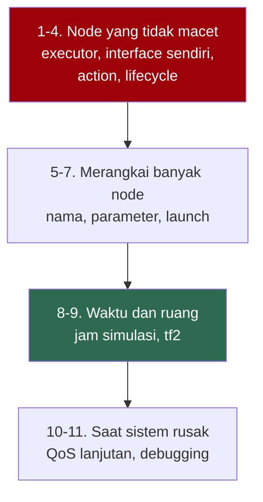
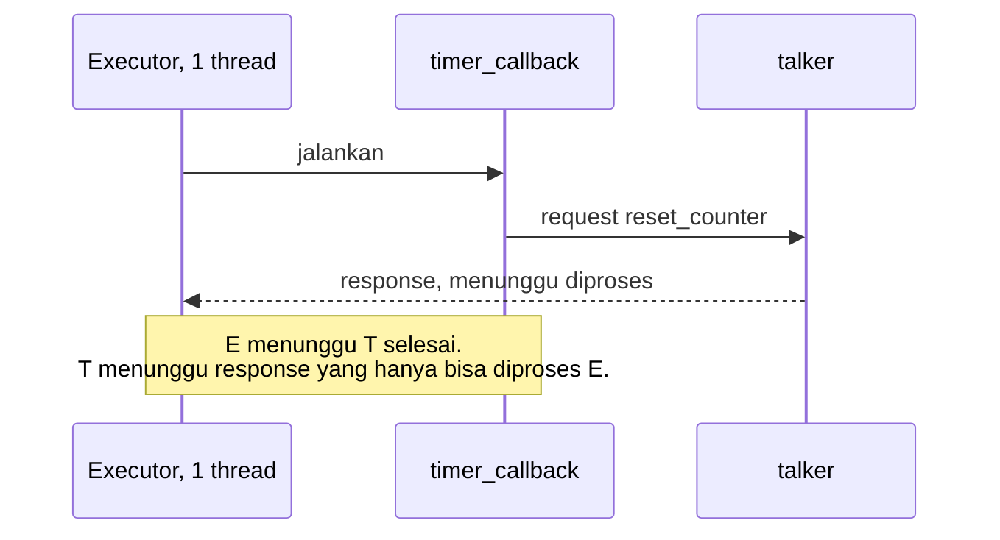
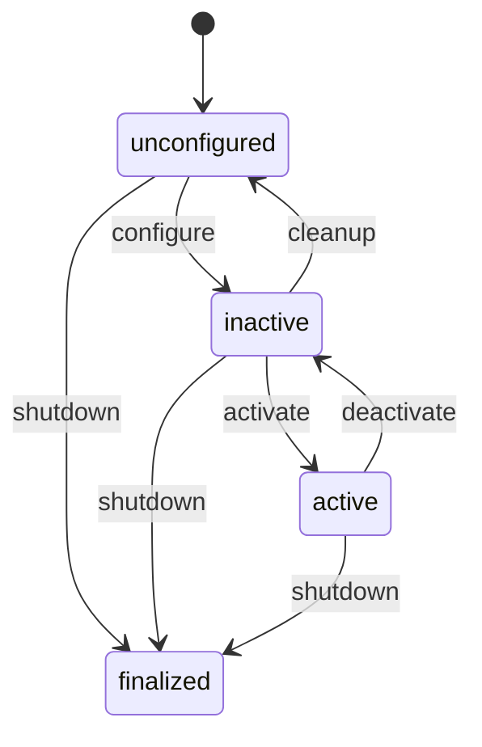
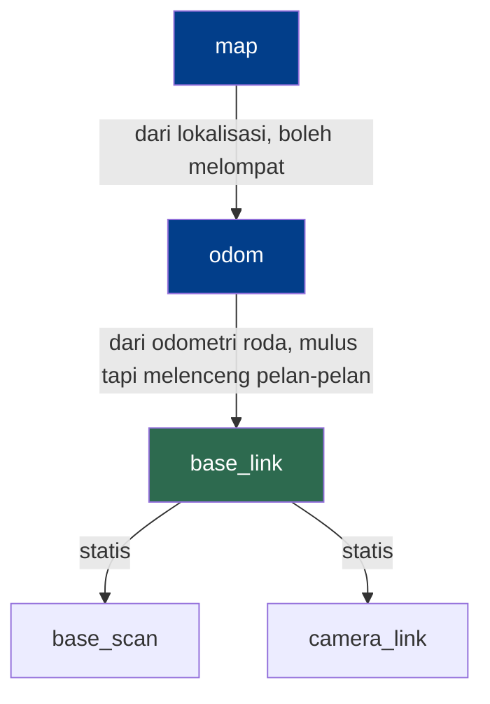

# Lanjutan ROS 2

Materi ini melanjutkan `dasar-ros2.md`. Semua contoh di sini memakai workspace `~/ros2_ws` dan package `latihan_ros` dari materi dasar, jadi selesaikan dulu materi itu, termasuk semua node di bagian 11, 12, dan 14.

Seperti materi dasar, semuanya berjalan di turtlesim dan RViz2. Gazebo belum dipakai, sehingga materi ini jalan di semua sistem operasi, termasuk macOS.

Kerjakan sambil mengetik. Setiap bagian menambah file ke package yang sama, dan beberapa bagian memakai hasil bagian sebelumnya.

## Peta materi



Bagian 1 menjelaskan kenapa node bisa macet tanpa pesan error apa pun. Bagian 9 yang paling banyak kalian pakai begitu masuk ke Gazebo dan Nav2.

## 1. Executor dan callback group

Bagian 11 materi dasar memperingatkan bahwa memanggil service secara sinkron dari dalam callback membuat node macet. Di sini kita buat macetnya dengan sengaja, lalu bongkar penyebabnya. Penyebab yang sama muncul lagi di action pada bagian 3 dan di tf2 pada bagian 9.

### Membuat node macet

Buat file `~/ros2_ws/src/latihan_ros/latihan_ros/reset_macet.py`:

```python
import rclpy
from rclpy.node import Node
from std_srvs.srv import Trigger


class ResetMacet(Node):
    def __init__(self):
        super().__init__('reset_macet')
        self.client = self.create_client(Trigger, 'reset_counter')
        self.timer = self.create_timer(5.0, self.timer_callback)

    def timer_callback(self):
        self.get_logger().info('memanggil reset_counter...')
        response = self.client.call(Trigger.Request())
        self.get_logger().info(f'jawaban: {response.message}')


def main():
    rclpy.init()
    node = ResetMacet()
    rclpy.spin(node)
    node.destroy_node()
    rclpy.shutdown()


if __name__ == '__main__':
    main()
```

Bedanya dengan `reset_berkala` di materi dasar ada di `self.client.call(...)`. Ini versi sinkron, yang baru kembali setelah jawaban datang.

Daftarkan `'reset_macet = latihan_ros.reset_macet:main',` di `entry_points`, build ulang, lalu jalankan talker dan listener di dua terminal. Di terminal ketiga:

```bash
ros2 run latihan_ros reset_macet
```

Lima detik kemudian muncul satu baris, lalu tidak ada apa-apa lagi:

```
[INFO] [1792030747.582274977] [reset_macet]: memanggil reset_counter...
```

Perhatikan listener. Hitungannya kembali ke 0 satu kali, jadi permintaan sampai ke talker dan talker sudah menjawab. Yang tidak pernah sampai adalah jawaban itu ke `reset_macet`. Node itu juga tidak memanggil lagi lima detik kemudian, padahal timernya masih ada.

Tekan Ctrl-C di terminal ketiga. Traceback yang keluar menunjukkan baris tempat node itu berhenti:

```
  File ".../latihan_ros/reset_macet.py", line 14, in timer_callback
  File "/opt/ros/jazzy/lib/python3.12/site-packages/rclpy/client.py", line 105, in call
  File "/usr/lib/python3.12/threading.py", line 655, in wait
```

Ingat trik ini. Menekan Ctrl-C pada node yang menggantung adalah cara tercepat untuk tahu baris mana yang sedang ditunggunya.

### Kenapa macet

`rclpy.spin(node)` menjalankan sebuah executor, yaitu loop yang menunggu sesuatu siap lalu memanggil callback yang cocok: timer berbunyi, pesan datang, jawaban service datang. Executor bawaan cuma punya satu thread, jadi callback dipanggil satu per satu.



Jawaban dari talker sudah tiba, tapi yang bisa memprosesnya cuma executor, dan executor sedang sibuk menjalankan `timer_callback`. Callback itu sendiri sedang menunggu jawaban tadi. Keduanya saling menunggu selamanya.

Ada dua hal yang menentukan apakah dua callback boleh berjalan bersamaan:

| Konsep | Menentukan | Bawaan |
|---|---|---|
| Executor | Berapa thread yang tersedia | `rclpy.spin` memakai `SingleThreadedExecutor`, satu thread |
| Callback group | Callback mana yang boleh berjalan bersamaan | Semua callback satu node masuk satu grup `MutuallyExclusiveCallbackGroup` |

Callback group ada dua jenis:

| Jenis | Aturan |
|---|---|
| `MutuallyExclusiveCallbackGroup` | Anggotanya bergiliran, satu per satu |
| `ReentrantCallbackGroup` | Anggotanya boleh berjalan bersamaan, termasuk callback yang sama dengan dirinya sendiri |

Yang dihitung sebagai callback bukan cuma fungsi yang kalian tulis. Pemrosesan jawaban untuk sebuah client juga callback, dan ikut grup client tersebut.

### Memperbaiki dengan callback group

Buat file `~/ros2_ws/src/latihan_ros/latihan_ros/reset_sinkron.py`:

```python
import rclpy
from rclpy.callback_groups import MutuallyExclusiveCallbackGroup
from rclpy.executors import MultiThreadedExecutor
from rclpy.node import Node
from std_srvs.srv import Trigger


class ResetSinkron(Node):
    def __init__(self):
        super().__init__('reset_sinkron')
        self.client = self.create_client(
            Trigger, 'reset_counter', callback_group=MutuallyExclusiveCallbackGroup())
        self.timer = self.create_timer(5.0, self.timer_callback)

    def timer_callback(self):
        self.get_logger().info('memanggil reset_counter...')
        response = self.client.call(Trigger.Request())
        self.get_logger().info(f'jawaban: {response.message}')


def main():
    rclpy.init()
    node = ResetSinkron()
    executor = MultiThreadedExecutor()
    executor.add_node(node)
    executor.spin()
    node.destroy_node()
    rclpy.shutdown()


if __name__ == '__main__':
    main()
```

Ada dua perubahan. Client masuk ke grupnya sendiri, dan node dijalankan dengan `MultiThreadedExecutor`, yang punya beberapa thread. Selama satu thread menunggu di dalam `timer_callback`, thread lain bebas memproses jawaban, karena jawaban itu ada di grup yang tidak sedang dipakai.

Daftarkan `'reset_sinkron = latihan_ros.reset_sinkron:main',`, build ulang, lalu jalankan. Jawaban kini muncul setiap lima detik:

```
[INFO] [1792030498.154475321] [reset_sinkron]: memanggil reset_counter...
[INFO] [1792030498.156187138] [reset_sinkron]: jawaban: hitungan kembali ke 0
```

Kedua perubahan itu sama-sama wajib:

| Executor | Client di grup sendiri | Hasil |
|---|---|---|
| `SingleThreadedExecutor` | tidak | Macet |
| `SingleThreadedExecutor` | ya | Macet, karena satu-satunya thread sedang menunggu |
| `MultiThreadedExecutor` | tidak | Macet, karena grup bawaan masih dipegang `timer_callback` |
| `MultiThreadedExecutor` | ya | Jalan |

Node yang macet di `MultiThreadedExecutor` tidak berhenti dengan satu kali Ctrl-C, karena thread yang sedang menunggu tidak pernah selesai. Tekan Ctrl-C sekali lagi.

### Tiga cara yang benar

| Cara | Syarat | Contoh |
|---|---|---|
| `call_async` lalu `add_done_callback` | Tidak ada | `reset_berkala` di materi dasar |
| Callback `async def` dengan `await self.client.call_async(...)` | Client di callback group sendiri | Di bawah |
| `call()` sinkron | Client di callback group sendiri dan `MultiThreadedExecutor` | `reset_sinkron` |

Cara kedua cuma butuh satu thread. Ganti `timer_callback` di `reset_sinkron.py` dengan:

```python
    async def timer_callback(self):
        self.get_logger().info('memanggil reset_counter...')
        response = await self.client.call_async(Trigger.Request())
        self.get_logger().info(f'jawaban: {response.message}')
```

lalu ganti tiga baris executor di `main` dengan `rclpy.spin(node)`. Node tetap jalan. Kalau client-nya dikembalikan ke grup bawaan, node macet lagi: callback `async` yang sedang menunggu tetap memegang grupnya sampai selesai.

Untuk kebanyakan node, cara pertama paling aman karena tidak bergantung pada pengaturan apa pun.

### Thread di Python bukan kerja paralel

`MultiThreadedExecutor` di Python membantu kalau callback-nya menunggu, misalnya menunggu jawaban service, `sleep`, atau membaca perangkat. Ia tidak membuat hitungan berat berjalan paralel. Interpreter Python cuma menjalankan kode Python dari satu thread pada satu waktu, berapa pun jumlah thread-nya.

Kalau sebuah callback menghitung lama, misalnya memproses gambar, pisahkan ke node lain yang berjalan sebagai proses sendiri. Itu saran yang sama dengan tabel kesalahan di materi dasar.

### Beberapa node dalam satu proses

Bagian 5 materi dasar bilang node bukan proses. Satu executor bisa menjalankan beberapa node sekaligus. Buat file `~/ros2_ws/src/latihan_ros/latihan_ros/dua_node.py`:

```python
import rclpy
from rclpy.executors import SingleThreadedExecutor

from latihan_ros.listener import Listener
from latihan_ros.talker import Talker


def main():
    rclpy.init()
    executor = SingleThreadedExecutor()
    executor.add_node(Talker())
    executor.add_node(Listener())
    executor.spin()
    rclpy.shutdown()


if __name__ == '__main__':
    main()
```

Daftarkan `'dua_node = latihan_ros.dua_node:main',`, build ulang, jalankan, lalu periksa dari terminal lain:

```bash
ros2 run latihan_ros dua_node
ros2 node list
```

`ros2 node list` menampilkan `/listener` dan `/talker`, padahal yang berjalan cuma satu proses. Kelas `Talker` dan `Listener` dipakai ulang tanpa diubah sedikit pun.

## 2. Interface sendiri

Tipe bawaan seperti `std_msgs/msg/String` dan `geometry_msgs/msg/Twist` cukup untuk banyak hal. Begitu data kalian punya bentuk sendiri, misalnya status robot dengan beberapa kolom, kalian butuh tipe sendiri.

Aturan pertama: interface tidak bisa dibuat di package Python. Pembuat kode interface ROS cuma berjalan di package `ament_cmake`. Jadi kita buat package kedua yang khusus berisi interface, lalu `latihan_ros` memakainya.

```bash
cd ~/ros2_ws/src
ros2 pkg create --build-type ament_cmake --license Apache-2.0 latihan_interfaces
mkdir latihan_interfaces/msg latihan_interfaces/action
```

Folder `include` dan `src` yang ikut dibuat tidak dipakai. Biarkan saja.

```
ros2_ws/src/
├── latihan_ros/              package Python, berisi node
└── latihan_interfaces/       package CMake, berisi interface saja
    ├── CMakeLists.txt
    ├── package.xml
    ├── msg/
    │   └── Status.msg
    └── action/
        └── Maju.action
```

### Menulis interface

Buat file `~/ros2_ws/src/latihan_interfaces/msg/Status.msg`:

```
std_msgs/Header header
string nama
float32 baterai
bool sibuk
```

Buat file `~/ros2_ws/src/latihan_interfaces/action/Maju.action`:

```
# Goal
float32 jarak
---
# Result
float32 ditempuh
---
# Feedback
float32 sisa
```

`Maju` dipakai di bagian 3 untuk menggerakkan kura-kura maju sejauh `jarak`. Service ditulis dengan cara yang sama di folder `srv`, dengan dua bagian yang dipisah `---`.

Penamaannya diperiksa ketat:

| Yang dinamai | Aturan | Contoh benar | Contoh salah |
|---|---|---|---|
| Tipe, yaitu nama file | Diawali huruf besar, tanpa garis bawah | `Status.msg` | `status.msg` |
| Field | Huruf kecil, angka, dan garis bawah, diawali huruf | `baterai` | `Baterai` |

### Mendaftarkan dan membangun

Tambahkan di `latihan_interfaces/CMakeLists.txt`, tepat sebelum baris `ament_package()`:

```cmake
find_package(rosidl_default_generators REQUIRED)
find_package(std_msgs REQUIRED)

rosidl_generate_interfaces(${PROJECT_NAME}
  "msg/Status.msg"
  "action/Maju.action"
  DEPENDENCIES std_msgs
)
```

Tambahkan di `latihan_interfaces/package.xml`, di bawah baris `<buildtool_depend>ament_cmake</buildtool_depend>`:

```xml
  <buildtool_depend>rosidl_default_generators</buildtool_depend>
  <depend>std_msgs</depend>
  <exec_depend>rosidl_default_runtime</exec_depend>
  <member_of_group>rosidl_interface_packages</member_of_group>
```

| Baris | Gunanya |
|---|---|
| `rosidl_generate_interfaces(...)` | Daftar file yang diubah menjadi kode Python dan C++ |
| `DEPENDENCIES std_msgs` | `Status` memakai `std_msgs/Header`. Setiap package interface lain yang dipakai wajib disebut di sini |
| `<member_of_group>rosidl_interface_packages</member_of_group>` | Menandai package ini sebagai package interface |

Build dari akar workspace seperti biasa:

```bash
cd ~/ros2_ws
colcon build --symlink-install
source install/setup.bash
ros2 interface show latihan_interfaces/msg/Status
```

```
std_msgs/Header header
	builtin_interfaces/Time stamp
		int32 sec
		uint32 nanosec
	string frame_id
string nama
float32 baterai
bool sibuk
```

Coba tanpa menulis kode. Terminal 1:

```bash
ros2 topic echo /status latihan_interfaces/msg/Status
```

Terminal 2:

```bash
ros2 topic pub --once /status latihan_interfaces/msg/Status "{header: {stamp: now, frame_id: base_link}, nama: robot1, baterai: 0.75, sibuk: false}"
```

Kata `now` diisi waktu saat itu oleh `ros2 topic pub`. Terminal 1 mencetak:

```
header:
  stamp:
    sec: 1792030417
    nanosec: 199560429
  frame_id: base_link
nama: robot1
baterai: 0.75
sibuk: false
---
```

Tipe topic sengaja ditulis di perintah `echo`. Dengan begitu `echo` bisa mulai mendengarkan sebelum ada publisher.

### Memakai interface dari package lain

Package yang memakai interface ini harus menyebutnya di `package.xml`-nya sendiri, misalnya `<depend>latihan_interfaces</depend>` di `latihan_ros`. Dengan baris itu `colcon` tahu bahwa `latihan_interfaces` harus dibangun lebih dulu. Di kode Python, import-nya sama seperti tipe bawaan:

```python
from latihan_interfaces.action import Maju
from latihan_interfaces.msg import Status
```

Setiap kali isi file `.msg` atau `.action` berubah, build ulang, source ulang, lalu jalankan ulang semua node yang memakainya.

| Gejala | Penyebab |
|---|---|
| Build gagal, `'Baterai' is an invalid field name.  It should have the pattern '^(?!.*__)(?!.*_$)[a-z][a-z0-9_]*$'` | Nama field diawali huruf besar |
| Build gagal, `'status' is an invalid message name.  It should have the pattern '^[A-Z][A-Za-z0-9]*$'` | Nama file diawali huruf kecil |
| Build gagal dengan `KeyError: 'std_msgs'` | Lupa `DEPENDENCIES std_msgs` di `rosidl_generate_interfaces` |
| `ModuleNotFoundError: No module named 'latihan_interfaces'` | Belum `source install/setup.bash` setelah build |

## 3. Action lanjutan

`fibonacci_server` di materi dasar punya dua kekurangan yang sudah disebut di sana. Selama satu goal berjalan, node itu tidak bisa mengerjakan hal lain, dan goal-nya tidak bisa dibatalkan. Server yang menggerakkan robot sungguhan tidak boleh begitu. Robot harus bisa dihentikan di tengah jalan, dan selama bergerak ia harus terus membaca sensornya.

Server di bagian ini memakai `Maju` dari bagian 2. Kura-kura maju lurus sejauh `jarak` sambil terus membaca posisinya sendiri. Bentuknya sama dengan yang dikerjakan Nav2 dalam skala besar: menerima tujuan, bergerak sambil memantau posisi, melaporkan kemajuan, dan berhenti kalau dibatalkan.

### Menulis server yang bisa dibatalkan

Tambahkan di `latihan_ros/package.xml`:

```xml
  <depend>geometry_msgs</depend>
  <depend>latihan_interfaces</depend>
```

Buat file `~/ros2_ws/src/latihan_ros/latihan_ros/maju_server.py`:

```python
import math
import time

import rclpy
from rclpy.action import ActionServer, CancelResponse, GoalResponse
from rclpy.callback_groups import ReentrantCallbackGroup
from rclpy.executors import MultiThreadedExecutor
from rclpy.node import Node
from geometry_msgs.msg import Twist
from turtlesim.msg import Pose
from latihan_interfaces.action import Maju


class MajuServer(Node):
    def __init__(self):
        super().__init__('maju_server')
        self.pose = None
        self.create_subscription(Pose, 'turtle1/pose', self.pose_callback, 10)
        self.cmd_pub = self.create_publisher(Twist, 'turtle1/cmd_vel', 10)
        self.server = ActionServer(
            self, Maju, 'maju', self.execute_callback,
            goal_callback=self.goal_callback,
            cancel_callback=self.cancel_callback,
            callback_group=ReentrantCallbackGroup(),
        )

    def pose_callback(self, msg):
        self.pose = msg

    def goal_callback(self, goal_request):
        if self.pose is None or goal_request.jarak <= 0.0:
            return GoalResponse.REJECT
        return GoalResponse.ACCEPT

    def cancel_callback(self, goal_handle):
        return CancelResponse.ACCEPT

    def execute_callback(self, goal_handle):
        x0, y0 = self.pose.x, self.pose.y
        jarak = goal_handle.request.jarak
        maju = Twist()
        maju.linear.x = 1.0
        feedback = Maju.Feedback()
        result = Maju.Result()

        while True:
            result.ditempuh = math.hypot(self.pose.x - x0, self.pose.y - y0)
            if goal_handle.is_cancel_requested:
                self.cmd_pub.publish(Twist())
                goal_handle.canceled()
                return result
            if result.ditempuh >= jarak:
                break
            self.cmd_pub.publish(maju)
            feedback.sisa = jarak - result.ditempuh
            goal_handle.publish_feedback(feedback)
            time.sleep(0.1)

        self.cmd_pub.publish(Twist())
        goal_handle.succeed()
        return result


def main():
    rclpy.init()
    node = MajuServer()
    executor = MultiThreadedExecutor()
    executor.add_node(node)
    executor.spin()
    node.destroy_node()
    rclpy.shutdown()


if __name__ == '__main__':
    main()
```

| Bagian | Kenapa begitu |
|---|---|
| `goal_callback` | Dipanggil sebelum goal diterima. Goal ditolak kalau posisi kura-kura belum diketahui atau jaraknya tidak masuk akal |
| `cancel_callback` | Bawaannya menolak semua pembatalan. Di sini diterima |
| `goal_handle.is_cancel_requested` | Pembatalan tidak menghentikan `execute_callback` secara paksa. Kode kalian yang harus mengecek, berhenti, lalu memanggil `canceled()` |
| `self.cmd_pub.publish(Twist())` | `Twist` kosong berarti kecepatan nol. Robot yang dibatalkan harus benar-benar diam |
| `ReentrantCallbackGroup` dan `MultiThreadedExecutor` | `execute_callback` berjalan lama. Thread lain tetap bebas memproses `pose_callback` dan permintaan pembatalan |
| `time.sleep(0.1)` | Aman di sini, karena yang tertahan cuma satu thread |
| `'turtle1/pose'` tanpa garis miring depan | Nama relatif. Alasannya ada di bagian 5 |

Daftarkan `'maju_server = latihan_ros.maju_server:main',`, build ulang, lalu jalankan `turtlesim_node` di terminal 1 dan `maju_server` di terminal 2. Di terminal 3:

```bash
ros2 action send_goal --feedback /maju latihan_interfaces/action/Maju "{jarak: 3.0}"
```

Kura-kura maju tiga satuan lalu berhenti. Keluarannya dipotong di sini:

```
Goal accepted with ID: 282207c2cb3a40a5a37f5386a8bd45a0

Feedback:
    sisa: 3.0

Feedback:
    sisa: 2.9039998054504395

...

Result:
    ditempuh: 3.007999897003174

Goal finished with status: SUCCEEDED
```

Sekarang goal yang tidak masuk akal:

```bash
ros2 action send_goal /maju latihan_interfaces/action/Maju "{jarak: -1.0}"
```

```
Goal was rejected.
```

### Membatalkan dari CLI

Kirim goal yang tidak mungkin selesai. Kura-kura akan menabrak dinding sebelum menempuh 20 satuan:

```bash
ros2 action send_goal --feedback /maju latihan_interfaces/action/Maju "{jarak: 20.0}"
```

Tekan Ctrl-C sebelum kura-kura sampai di dinding. CLI mencetak `Canceling goal...`, lalu keluar dengan pesan `Executor is already spinning`. Pesan itu kesalahan milik `ros2 action` sendiri di Jazzy, bukan milik server kalian. Permintaan pembatalannya sudah terkirim sebelum pesan itu muncul. Kura-kura berhenti, dan statusnya bisa dilihat dari topic tersembunyi milik action:

```bash
ros2 topic echo --once /maju/_action/status
```

Carilah `status: 5`. Setiap action sebenarnya tersusun dari beberapa topic dan service tersembunyi, dan `ros2 topic list --include-hidden-topics` menampilkan semuanya.

| Kode status | Arti |
|---|---|
| 4 | `SUCCEEDED` |
| 5 | `CANCELED` |
| 6 | `ABORTED` |

### Membatalkan dari kode

Klien berikut mengirim goal 20 satuan dan memberinya waktu dua detik. Kalau belum selesai, goal dibatalkan. Pola "tunggu sebentar, kalau tidak selesai batalkan" sering dipakai untuk robot sungguhan.

Buat file `~/ros2_ws/src/latihan_ros/latihan_ros/maju_client.py`:

```python
import rclpy
from rclpy.action import ActionClient
from rclpy.node import Node
from latihan_interfaces.action import Maju

JARAK = 20.0
BATAS_WAKTU = 2.0


class MajuClient(Node):
    def __init__(self):
        super().__init__('maju_client')
        self.client = ActionClient(self, Maju, 'maju')

    def send_goal(self, jarak):
        goal = Maju.Goal()
        goal.jarak = jarak
        self.client.wait_for_server()
        return self.client.send_goal_async(goal)


def main():
    rclpy.init()
    node = MajuClient()

    goal_future = node.send_goal(JARAK)
    rclpy.spin_until_future_complete(node, goal_future)
    goal_handle = goal_future.result()
    if not goal_handle.accepted:
        node.get_logger().info('goal ditolak')
        node.destroy_node()
        rclpy.shutdown()
        return

    result_future = goal_handle.get_result_async()
    rclpy.spin_until_future_complete(node, result_future, timeout_sec=BATAS_WAKTU)
    if not result_future.done():
        node.get_logger().info(f'{BATAS_WAKTU} detik lewat, goal dibatalkan')
        cancel_future = goal_handle.cancel_goal_async()
        rclpy.spin_until_future_complete(node, cancel_future)
        rclpy.spin_until_future_complete(node, result_future)

    hasil = result_future.result()
    node.get_logger().info(f'status {hasil.status}, ditempuh {hasil.result.ditempuh:.2f}')
    node.destroy_node()
    rclpy.shutdown()


if __name__ == '__main__':
    main()
```

| Baris | Kenapa begitu |
|---|---|
| `spin_until_future_complete(..., timeout_sec=BATAS_WAKTU)` | Berhenti menunggu setelah dua detik, entah future-nya sudah terisi atau belum |
| `result_future.done()` | Membedakan dua kemungkinan tadi |
| `goal_handle.cancel_goal_async()` | Mengirim permintaan pembatalan. Server tetap mengirim result setelah benar-benar berhenti, jadi result-nya ditunggu lagi sesudahnya |

Kembalikan kura-kura ke tengah dulu dengan service milik turtlesim, lalu jalankan klien:

```bash
ros2 service call /reset std_srvs/srv/Empty
ros2 run latihan_ros maju_client
```

```
[INFO] [1792030827.749694225] [maju_client]: 2.0 detik lewat, goal dibatalkan
[INFO] [1792030827.752240582] [maju_client]: status 5, ditempuh 1.98
```

### Merusaknya dengan sengaja

Supaya alasan di balik `MultiThreadedExecutor` terasa, ganti tiga baris executor di `main` milik `maju_server.py` dengan `rclpy.spin(node)`. Kembalikan kura-kura ke tengah, jalankan server yang sudah diubah, lalu jalankan `maju_client`.

Kura-kura melaju terus sampai menabrak dinding. Terminal turtlesim mencetak:

```
[WARN] [1792030885.311545574] [turtlesim]: Oh no! I hit the wall! (Clamping from [x=11.096445, y=5.544445])
```

Klien mencetak `2.0 detik lewat, goal dibatalkan`, lalu diam selamanya. Dengan satu thread, `execute_callback` memegang executor sepanjang goal berjalan. `pose_callback` tidak pernah dipanggil, jadi `ditempuh` tetap nol, dan permintaan pembatalan tidak pernah diproses. Ini masalah bagian 1 dalam bentuk lain.

Kembalikan `main` seperti semula sebelum lanjut.

## 4. Lifecycle node

Node biasa langsung bekerja begitu dijalankan. Untuk sistem besar itu merepotkan. Nav2 misalnya terdiri dari banyak server yang saling bergantung. Perencana jalur tidak berguna sebelum peta dimuat, dan pengendali tidak boleh menggerakkan roda sebelum semuanya siap. Karena itu server-server Nav2 ditulis sebagai lifecycle node, yaitu node yang punya tahapan hidup dan baru bekerja setelah disuruh.



| State | Artinya |
|---|---|
| `unconfigured` | Baru lahir, belum menyiapkan apa pun |
| `inactive` | Publisher, timer, dan parameter sudah disiapkan, tapi belum ada yang dikirim keluar |
| `active` | Bekerja |
| `finalized` | Selesai, tinggal dimatikan |

### Menulis lifecycle node

Buat file `~/ros2_ws/src/latihan_ros/latihan_ros/lc_talker.py`:

```python
import rclpy
from rclpy.lifecycle import LifecycleNode, TransitionCallbackReturn
from std_msgs.msg import String


class LcTalker(LifecycleNode):
    def __init__(self):
        super().__init__('lc_talker')
        self.count = 0

    def on_configure(self, state):
        self.pub = self.create_lifecycle_publisher(String, 'chatter', 10)
        self.timer = self.create_timer(0.5, self.timer_callback)
        self.get_logger().info('configure: publisher dan timer dibuat')
        return TransitionCallbackReturn.SUCCESS

    def on_activate(self, state):
        self.get_logger().info('activate: mulai mengirim')
        return super().on_activate(state)

    def on_deactivate(self, state):
        self.get_logger().info('deactivate: berhenti mengirim')
        return super().on_deactivate(state)

    def on_cleanup(self, state):
        self.destroy_timer(self.timer)
        self.destroy_publisher(self.pub)
        self.get_logger().info('cleanup: kembali ke awal')
        return TransitionCallbackReturn.SUCCESS

    def timer_callback(self):
        msg = String()
        msg.data = f'halo {self.count}'
        self.pub.publish(msg)
        self.count += 1


def main():
    rclpy.init()
    node = LcTalker()
    rclpy.spin(node)
    node.destroy_node()
    rclpy.shutdown()


if __name__ == '__main__':
    main()
```

| Bagian | Kenapa begitu |
|---|---|
| `LifecycleNode` | Pengganti `Node` untuk node yang punya tahapan hidup |
| `on_configure`, `on_activate`, dan seterusnya | Dipanggil saat node berpindah state. Kembalikan `SUCCESS`, atau `FAILURE` untuk menolak perpindahan |
| `create_lifecycle_publisher` | Publisher yang cuma benar-benar mengirim saat node `active`. Di luar itu, pesannya dibuang diam-diam |
| `super().on_activate(state)` | Baris inilah yang menyalakan lifecycle publisher. Kalau lupa, node melaporkan `active` tapi tidak mengirim apa pun, tanpa pesan error |

### Menggerakkan dari state ke state

Daftarkan `'lc_talker = latihan_ros.lc_talker:main',` dan build ulang. Matikan talker kalau masih berjalan, karena node ini juga mengirim ke `/chatter`. Jalankan `ros2 run latihan_ros lc_talker` di terminal 1 dan `ros2 topic echo /chatter` di terminal 2. Dari terminal 3:

```bash
ros2 lifecycle nodes
ros2 lifecycle get /lc_talker
```

Jawabannya `/lc_talker` dan `unconfigured [1]`. `ros2 topic list` belum menampilkan `/chatter`, karena publisher-nya baru dibuat saat configure.

```bash
ros2 lifecycle set /lc_talker configure
ros2 lifecycle get /lc_talker
```

Jawabannya `Transitioning successful` dan `inactive [2]`. Terminal 2 masih diam. Timer sebenarnya sudah berjalan dan `publish` sudah dipanggil, tapi lifecycle publisher membuang pesannya.

```bash
ros2 lifecycle set /lc_talker activate
```

Terminal 2 mulai mencetak, dan angka pertamanya bukan 0:

```
data: halo 16
---
```

Hitungannya terus naik selama `inactive`, karena timer tetap berbunyi walaupun tidak ada yang dikirim. Ini bentuk nyata dari "node hidup tapi diam".

```bash
ros2 lifecycle list /lc_talker
ros2 lifecycle set /lc_talker deactivate
```

`list` menampilkan perpindahan yang boleh dilakukan dari state sekarang, dan `deactivate` menghentikan kiriman lagi. Setiap perpindahan juga diumumkan di topic `/lc_talker/transition_event`.

Nav2 menyalakan server-servernya lewat node bernama `lifecycle_manager`, yang memanggil configure lalu activate satu per satu. Kalau Nav2 diam saja, periksa dengan `ros2 lifecycle get` apakah semua server-nya sudah `active`.

## 5. Nama

Bagian 17 materi dasar menyebut beda `chatter` dan `/chatter`. Di sini aturannya lengkap, karena aturan inilah yang membuat satu kode bisa dipakai untuk banyak robot sekaligus.

Buat file `~/ros2_ws/src/latihan_ros/latihan_ros/putar.py`:

```python
import rclpy
from rclpy.node import Node
from geometry_msgs.msg import Twist


class Putar(Node):
    def __init__(self):
        super().__init__('putar')
        self.declare_parameter('linear', 1.0)
        self.declare_parameter('angular', 1.0)
        self.pub = self.create_publisher(Twist, 'cmd_vel', 10)
        self.timer = self.create_timer(0.1, self.timer_callback)

    def timer_callback(self):
        msg = Twist()
        msg.linear.x = self.get_parameter('linear').value
        msg.angular.z = self.get_parameter('angular').value
        self.pub.publish(msg)


def main():
    rclpy.init()
    node = Putar()
    rclpy.spin(node)
    node.destroy_node()
    rclpy.shutdown()


if __name__ == '__main__':
    main()
```

Node ini menggerakkan kura-kura melingkar. Perhatikan bahwa nama topic-nya cuma `cmd_vel`, tanpa garis miring dan tanpa menyebut kura-kura mana.

### Tiga jenis nama

| Ditulis di kode | Node `putar` tanpa namespace | Node `putar` di namespace `/turtle1` |
|---|---|---|
| `cmd_vel`, relatif | `/cmd_vel` | `/turtle1/cmd_vel` |
| `/cmd_vel`, absolut | `/cmd_vel` | `/cmd_vel` |
| `~/cmd_vel`, privat | `/putar/cmd_vel` | `/turtle1/putar/cmd_vel` |

Nama relatif ditempelkan ke namespace node. Nama absolut tidak pernah berubah. Nama privat ditempelkan ke nama lengkap node, dan cocok untuk hal yang memang milik satu node saja.

### Satu kode, dua kura-kura

Daftarkan `'putar = latihan_ros.putar:main',` dan build ulang. Jalankan `turtlesim_node`, lalu munculkan kura-kura kedua:

```bash
ros2 service call /spawn turtlesim/srv/Spawn "{x: 3.0, y: 3.0, theta: 0.0, name: 'turtle2'}"
```

Jalankan `putar` dua kali dengan namespace berbeda, masing-masing di terminalnya sendiri:

```bash
ros2 run latihan_ros putar --ros-args -r __ns:=/turtle1
ros2 run latihan_ros putar --ros-args -r __ns:=/turtle2 -p angular:=-1.0
```

Kedua kura-kura berputar, dengan arah berlawanan. `ros2 node list` menampilkan:

```
/turtle1/putar
/turtle2/putar
/turtlesim
```

Kode yang sama menghasilkan dua node berbeda yang mengirim ke `/turtle1/cmd_vel` dan `/turtle2/cmd_vel`. Robot sungguhan memakai cara yang sama: kalau ada dua robot, semua node milik masing-masing robot dijalankan dalam namespace robotnya.

Sekarang jalankan satu lagi tanpa namespace:

```bash
ros2 run latihan_ros putar --ros-args -r __node:=putar_nyasar
ros2 topic info /cmd_vel
```

Node ini mengirim ke `/cmd_vel`, dan `ros2 topic info` menunjukkan `Subscription count: 0`. Tidak ada kura-kura yang mendengarkan topic itu, jadi tidak ada yang bergerak. Tidak ada pesan error juga.

| Argumen | Efeknya |
|---|---|
| `-r __ns:=/turtle1` | Memberi namespace pada node |
| `-r __node:=putar_nyasar` | Mengganti nama node |
| `-r cmd_vel:=/turtle1/cmd_vel` | Mengganti satu nama, disebut remap |
| `-p angular:=-1.0` | Mengisi parameter, seperti di materi dasar |

### Jebakan nama absolut

`rotate_client` dari materi dasar menulis `'/turtle1/rotate_absolute'`, nama absolut. Coba jalankan dalam namespace `/turtle2`:

```bash
ros2 run latihan_ros rotate_client --ros-args -r __ns:=/turtle2
```

Yang berputar tetap turtle1. Namespace tidak berpengaruh pada nama absolut. Remap tetap bisa menolong, dan berlaku juga untuk nama action:

```bash
ros2 run latihan_ros rotate_client --ros-args -r /turtle1/rotate_absolute:=/turtle2/rotate_absolute
```

Kali ini turtle2 yang berputar. Pelajarannya, tulis nama relatif di kode, lalu biarkan namespace dan remap yang menentukan tujuannya saat node dijalankan. `maju_server` di bagian 3 sudah ditulis begitu.

## 6. Parameter lanjutan

Bagian 14 materi dasar berhenti pada masalah ini: `ros2 param set` mengubah nilai yang disimpan, tapi node yang membacanya di konstruktor tidak tahu ada perubahan. Bagian ini membuat node bereaksi, menolak nilai yang salah, dan membaca parameter dari file.

### Bereaksi dan menolak

Ganti isi `~/ros2_ws/src/latihan_ros/latihan_ros/param_talker.py` dengan:

```python
import rclpy
from rclpy.node import Node
from rcl_interfaces.msg import FloatingPointRange, ParameterDescriptor, SetParametersResult
from std_msgs.msg import String


class ParamTalker(Node):
    def __init__(self):
        super().__init__('param_talker')
        self.declare_parameter('pesan', 'halo')
        self.declare_parameter(
            'period', 0.5,
            ParameterDescriptor(
                description='jeda antarpesan, dalam detik',
                floating_point_range=[FloatingPointRange(from_value=0.05, to_value=5.0)],
            ),
        )
        period = self.get_parameter('period').value
        self.pub = self.create_publisher(String, 'chatter', 10)
        self.timer = self.create_timer(period, self.timer_callback)
        self.add_on_set_parameters_callback(self.validasi)
        self.add_post_set_parameters_callback(self.terapkan)

    def validasi(self, params):
        for p in params:
            if p.name == 'pesan' and p.value == '':
                return SetParametersResult(successful=False, reason='pesan tidak boleh kosong')
        return SetParametersResult(successful=True)

    def terapkan(self, params):
        for p in params:
            if p.name == 'period':
                self.timer.timer_period_ns = int(p.value * 1e9)
                self.get_logger().info(f'period sekarang {p.value} detik')

    def timer_callback(self):
        msg = String()
        msg.data = self.get_parameter('pesan').value
        self.pub.publish(msg)


def main():
    rclpy.init()
    node = ParamTalker()
    rclpy.spin(node)
    node.destroy_node()
    rclpy.shutdown()


if __name__ == '__main__':
    main()
```

| Bagian | Gunanya |
|---|---|
| `ParameterDescriptor(...)` | Keterangan dan batas nilai. ROS sendiri yang menolak nilai di luar batas |
| `add_on_set_parameters_callback(self.validasi)` | Dipanggil sebelum nilai baru disimpan. Kembalikan `successful=False` untuk menolak. Dokumentasi resmi menegaskan callback ini tidak boleh mengubah apa pun, karena perubahannya masih bisa ditolak |
| `add_post_set_parameters_callback(self.terapkan)` | Dipanggil setelah nilai baru tersimpan. Di sinilah perubahan diterapkan |
| `self.timer.timer_period_ns = ...` | Mengubah periode timer yang sedang berjalan |

`--symlink-install` membuat perubahan isi file ini langsung berlaku, jadi tidak perlu build ulang. Jalankan `param_talker`, lalu dari terminal lain:

```bash
ros2 param describe /param_talker period
```

```
Parameter name: period
  Type: double
  Description: jeda antarpesan, dalam detik
  Constraints:
    Min value: 0.05
    Max value: 5.0
```

```bash
ros2 param set /param_talker period 0.1
ros2 topic hz /chatter
```

Kali ini `hz` langsung berubah ke sekitar 10, dan terminal node mencetak `period sekarang 0.1 detik`. Coba dua nilai yang salah:

```bash
ros2 param set /param_talker period 10.0
ros2 param set /param_talker pesan "''"
```

```
Setting parameter failed: Parameter period out of range Min: 0.05, Max: 5.0, value: 10.0
Setting parameter failed: pesan tidak boleh kosong
```

Yang pertama ditolak oleh batas di descriptor, yang kedua oleh `validasi`.

### Parameter dari file

Begitu jumlah parameternya banyak, mengetik `-p` satu per satu tidak masuk akal. Buat folder `~/ros2_ws/src/latihan_ros/config`, lalu buat file `~/ros2_ws/src/latihan_ros/config/putar.yaml`:

```yaml
/turtle1/putar:
  ros__parameters:
    linear: 2.0
    angular: 1.0

/turtle2/putar:
  ros__parameters:
    linear: 1.0
    angular: -2.0
```

Kunci paling atas adalah nama lengkap node, termasuk namespace-nya. Di bawahnya selalu `ros__parameters`, dengan dua garis bawah. Kunci `/**` berlaku untuk semua node.

```bash
ros2 run latihan_ros putar --ros-args -r __ns:=/turtle2 --params-file ~/ros2_ws/src/latihan_ros/config/putar.yaml
ros2 param get /turtle2/putar angular
```

Jawabannya `Double value is: -2.0`. Arah sebaliknya juga bisa. Isi parameter node yang sedang berjalan bisa disimpan ke file, dan file bisa dimuat ke node yang sedang berjalan:

```bash
ros2 param dump /param_talker
ros2 param load /turtle2/putar ~/ros2_ws/src/latihan_ros/config/putar.yaml
```

```
/param_talker:
  ros__parameters:
    period: 0.1
    pesan: halo
    start_type_description_service: true
    use_sim_time: false
```

Cara paling cepat membuat file parameter adalah menyetel node sampai perilakunya pas, lalu menyimpannya dengan `ros2 param dump`. Nav2 menyimpan pengaturannya dalam file YAML berbentuk sama, cuma jauh lebih panjang.

## 7. Launch lanjutan

Bagian 15 materi dasar menyebut bahwa launch file bisa menerima argumen, memuat file parameter, mengganti nama, dan memanggil launch file lain. Semuanya ada di contoh berikut.

File YAML dari bagian 6 harus ikut terpasang, karena launch file membacanya dari `install/`, bukan dari `src/`. Tambahkan baris ini ke `data_files` di `setup.py`, di bawah baris launch dari materi dasar:

```python
        (os.path.join('share', package_name, 'config'), glob('config/*.yaml')),
```

Buat file `~/ros2_ws/src/latihan_ros/launch/kura_kembar.launch.py`:

```python
import os

from ament_index_python.packages import get_package_share_directory
from launch import LaunchDescription
from launch.actions import DeclareLaunchArgument, ExecuteProcess, GroupAction
from launch.conditions import IfCondition
from launch.substitutions import LaunchConfiguration
from launch_ros.actions import Node, PushRosNamespace


def generate_launch_description():
    params = os.path.join(get_package_share_directory('latihan_ros'), 'config', 'putar.yaml')
    kura_kedua = LaunchConfiguration('kura_kedua')

    return LaunchDescription([
        DeclareLaunchArgument(
            'kura_kedua', default_value='true', description='munculkan dan putar turtle2'),
        Node(package='turtlesim', executable='turtlesim_node'),
        Node(package='latihan_ros', executable='putar', namespace='turtle1', parameters=[params]),
        GroupAction(
            condition=IfCondition(kura_kedua),
            actions=[
                ExecuteProcess(cmd=[
                    'ros2', 'service', 'call', '/spawn', 'turtlesim/srv/Spawn',
                    "{x: 3.0, y: 3.0, theta: 0.0, name: 'turtle2'}",
                ]),
                PushRosNamespace('turtle2'),
                Node(package='latihan_ros', executable='putar', parameters=[params]),
            ],
        ),
    ])
```

| Bagian | Gunanya |
|---|---|
| `DeclareLaunchArgument`, `LaunchConfiguration` | Argumen dari baris perintah, ditulis `kura_kedua:=false` |
| `get_package_share_directory('latihan_ros')` | Mencari folder `share` milik package yang sudah terpasang |
| `namespace='turtle1'` | Sama dengan `-r __ns:=/turtle1` |
| `parameters=[params]` | Sama dengan `--params-file`. Isinya juga boleh dict, misalnya `[{'angular': -1.0}]` |
| `GroupAction(condition=IfCondition(...))` | Semua isinya hanya dijalankan kalau syaratnya benar |
| `PushRosNamespace('turtle2')` | Memberi namespace ke semua node sesudahnya di dalam grup yang sama |
| `ExecuteProcess` | Menjalankan perintah biasa, di sini memanggil service `/spawn` |

Build ulang, karena ada file baru dan `setup.py` berubah. Lalu:

```bash
ros2 launch latihan_ros kura_kembar.launch.py --show-args
```

```
Arguments (pass arguments as '<name>:=<value>'):

    'kura_kedua':
        munculkan dan putar turtle2
        (default: 'true')
```

```bash
ros2 launch latihan_ros kura_kembar.launch.py
ros2 launch latihan_ros kura_kembar.launch.py kura_kedua:=false
```

Perintah pertama memunculkan dua kura-kura yang berputar dengan parameter dari `putar.yaml`. Perintah kedua cuma menjalankan turtle1.

Log dari semua node bercampur di satu terminal, dan setiap baris diberi awalan nama prosesnya, misalnya `[putar-2]`. Baris pertama juga menyebut folder tempat semua log disimpan, di bawah `~/.ros/log/`.

### Remap dan memanggil launch file lain

Remap di launch file ditulis sebagai daftar pasangan:

```python
Node(package='latihan_ros', executable='putar', name='putar_remap',
     remappings=[('cmd_vel', '/turtle1/cmd_vel')]),
```

Launch file lain dipanggil dengan `IncludeLaunchDescription`, beserta argumennya:

```python
from launch.actions import IncludeLaunchDescription
from launch.launch_description_sources import PythonLaunchDescriptionSource

IncludeLaunchDescription(
    PythonLaunchDescriptionSource(os.path.join(
        get_package_share_directory('latihan_ros'), 'launch', 'kura_kembar.launch.py')),
    launch_arguments={'kura_kedua': 'false'}.items(),
),
```

Dengan cara inilah sistem besar disusun. Bringup Nav2, misalnya, terdiri dari satu launch file utama yang memanggil launch file lain dengan argumen yang berbeda-beda. Biasakan membaca launch file orang lain dengan `--show-args` lebih dulu.

## 8. Waktu

Di ROS ada lebih dari satu jam, dan bedanya baru terasa begitu kalian memakai simulasi atau bag.

| Jam | Diambil dari | Dipakai untuk |
|---|---|---|
| Waktu dinding | Jam komputer | Stempel waktu di baris log, `time.time()` |
| Waktu ROS | Sama dengan waktu dinding, kecuali `use_sim_time` aktif. Kalau aktif, diambil dari topic `/clock` | Timer, stempel waktu pesan, tf2 |
| Waktu steady | Hitungan yang hanya maju, tidak pernah mundur | Mengukur lamanya sesuatu |

Buat file `~/ros2_ws/src/latihan_ros/latihan_ros/jam.py`:

```python
import time

import rclpy
from rclpy.node import Node


class Jam(Node):
    def __init__(self):
        super().__init__('jam')
        self.timer = self.create_timer(1.0, self.timer_callback)

    def timer_callback(self):
        waktu_ros = self.get_clock().now().nanoseconds / 1e9
        self.get_logger().info(f'waktu ROS {waktu_ros:.1f}, waktu dinding {time.time():.1f}')


def main():
    rclpy.init()
    node = Jam()
    rclpy.spin(node)
    node.destroy_node()
    rclpy.shutdown()


if __name__ == '__main__':
    main()
```

Daftarkan `'jam = latihan_ros.jam:main',`, build ulang, lalu jalankan dengan dua cara:

```bash
ros2 run latihan_ros jam
ros2 run latihan_ros jam --ros-args -p use_sim_time:=true
```

Cara pertama mencetak dua angka yang sama setiap detik. Cara kedua tidak mencetak apa pun. `use_sim_time` membuat node mengambil waktu dari `/clock`, dan karena belum ada yang menerbitkannya, waktu ROS diam di nol dan timer tidak pernah berbunyi. Tidak ada error. Node-nya hidup, cuma waktunya berhenti.

### Waktu dari bag

Bag bisa menerbitkan `/clock` sendiri. Rekam 10 detik pose kura-kura selagi `turtlesim_node` berjalan:

```bash
ros2 bag record -o rekaman_pose /turtle1/pose
```

Hentikan dengan Ctrl-C, matikan turtlesim, jalankan `jam` dengan `use_sim_time:=true` di satu terminal, lalu di terminal lain:

```bash
ros2 bag play rekaman_pose --clock --rate 2
```

```
[INFO] [1792031183.668937753] [jam]: waktu ROS 1792031161.3, waktu dinding 1792031183.7
[INFO] [1792031184.032164549] [jam]: waktu ROS 1792031162.0, waktu dinding 1792031184.0
[INFO] [1792031184.533011351] [jam]: waktu ROS 1792031163.0, waktu dinding 1792031184.5
```

Ada tiga hal yang terlihat di sini:

- Waktu ROS adalah waktu saat bag direkam, bukan waktu sekarang.
- Timer satu detik berbunyi setiap setengah detik waktu dinding, karena bag diputar dua kali lebih cepat.
- Angka di kurung siku pertama tetap waktu dinding, karena logger selalu memakai jam komputer.

### Aturan yang perlu dipegang

| Aturan | Akibat kalau dilanggar |
|---|---|
| Kalau ada `/clock`, dari simulasi atau dari bag, semua node memakai `use_sim_time:=true`, termasuk RViz2 | Stempel waktu tidak cocok, dan tf2 mengeluh soal extrapolation di bagian 9 |
| Stempel waktu pesan diisi `self.get_clock().now().to_msg()` | `time.time()` mengabaikan waktu simulasi |
| Durasi dan jeda di logika robot diukur dengan `self.get_clock()` | Memutar bag dua kali lebih cepat akan merusak logika yang memakai jam komputer |

Di launch file, `use_sim_time` diisi seperti parameter lain: `parameters=[{'use_sim_time': True}]`. Simulator seperti Gazebo menerbitkan `/clock` sendiri, jadi aturan ini akan kalian pakai setiap kali menjalankan simulasi.

## 9. tf2

Robot punya banyak kerangka acuan, disebut frame. Lidar melaporkan jarak rintangan relatif terhadap dirinya sendiri. Perencana jalur butuh posisi rintangan itu di peta. Di antara keduanya ada badan robot yang terus bergerak. tf2 mencatat hubungan antarframe beserta waktunya, sehingga node mana pun bisa bertanya "di mana titik ini kalau dilihat dari frame itu, pada waktu itu".

Setiap transform punya frame induk, frame anak, dan stempel waktu. Satu frame cuma boleh punya satu induk, jadi semua frame membentuk pohon.

### Konvensi

Dua REP mengatur konvensinya. REP 103 menetapkan satuan SI, yaitu meter, radian, dan detik, serta arah sumbu: x ke depan, y ke kiri, z ke atas. REP 105 menetapkan nama frame untuk robot bergerak:



| Frame | Artinya | Sifatnya |
|---|---|---|
| `map` | Peta | Posisi robot di sini akurat, tapi bisa melompat saat lokalisasi mengoreksi |
| `odom` | Titik awal odometri | Posisi robot di sini berubah mulus, tapi makin lama makin melenceng |
| `base_link` | Badan robot | Menempel di robot |
| `base_scan`, `camera_link` | Sensor | Tidak bergerak relatif terhadap `base_link` |

Nama-nama ini akan kalian temui lagi di Gazebo dan Nav2. Untuk sekarang kita latihan dengan frame yang lebih sederhana: `world` untuk arena turtlesim, dan satu frame untuk setiap kura-kura.

### Menyiarkan frame

Buat file `~/ros2_ws/src/latihan_ros/latihan_ros/kura_tf.py`:

```python
import math

import rclpy
from rclpy.node import Node
from geometry_msgs.msg import TransformStamped
from tf2_ros import TransformBroadcaster
from turtlesim.msg import Pose


class KuraTf(Node):
    def __init__(self):
        super().__init__('kura_tf')
        self.kura = self.declare_parameter('kura', 'turtle1').value
        self.broadcaster = TransformBroadcaster(self)
        self.create_subscription(Pose, f'/{self.kura}/pose', self.pose_callback, 10)

    def pose_callback(self, msg):
        t = TransformStamped()
        t.header.stamp = self.get_clock().now().to_msg()
        t.header.frame_id = 'world'
        t.child_frame_id = self.kura
        t.transform.translation.x = msg.x
        t.transform.translation.y = msg.y
        t.transform.rotation.z = math.sin(msg.theta / 2)
        t.transform.rotation.w = math.cos(msg.theta / 2)
        self.broadcaster.sendTransform(t)


def main():
    rclpy.init()
    node = KuraTf()
    rclpy.spin(node)
    node.destroy_node()
    rclpy.shutdown()


if __name__ == '__main__':
    main()
```

| Baris | Kenapa begitu |
|---|---|
| `header.frame_id = 'world'`, `child_frame_id = self.kura` | Induk dan anak. Transform ini menyatakan di mana kura-kura berada di dalam `world` |
| `header.stamp` | Waktu ROS, bukan `time.time()`. Lihat bagian 8 |
| `rotation.z = sin(theta / 2)`, `rotation.w = cos(theta / 2)` | Rotasi disimpan sebagai quaternion. Untuk putaran di sumbu z saja, rumusnya cukup dua baris ini |
| `sendTransform` | Mengirim ke topic `/tf`, yang didengarkan semua pengguna tf2 |

### Membaca frame

Node berikut membuat turtle2 mengejar turtle1. Setiap 0.1 detik ia bertanya ke tf2 di mana turtle1 kalau dilihat dari turtle2.

Buat file `~/ros2_ws/src/latihan_ros/latihan_ros/kejar.py`:

```python
import math

import rclpy
from rclpy.node import Node
from rclpy.time import Time
from geometry_msgs.msg import Twist
from tf2_ros import Buffer, TransformException, TransformListener


class Kejar(Node):
    def __init__(self):
        super().__init__('kejar')
        self.buffer = Buffer()
        self.listener = TransformListener(self.buffer, self)
        self.pub = self.create_publisher(Twist, '/turtle2/cmd_vel', 10)
        self.timer = self.create_timer(0.1, self.timer_callback)

    def timer_callback(self):
        try:
            t = self.buffer.lookup_transform('turtle2', 'turtle1', Time())
        except TransformException as e:
            self.get_logger().info(f'belum bisa: {e}')
            return
        x = t.transform.translation.x
        y = t.transform.translation.y
        msg = Twist()
        msg.linear.x = 0.5 * math.hypot(x, y)
        msg.angular.z = 4.0 * math.atan2(y, x)
        self.pub.publish(msg)


def main():
    rclpy.init()
    node = Kejar()
    rclpy.spin(node)
    node.destroy_node()
    rclpy.shutdown()


if __name__ == '__main__':
    main()
```

| Baris | Kenapa begitu |
|---|---|
| `Buffer()` dan `TransformListener(...)` | Listener mendengarkan `/tf` dan `/tf_static`, lalu menyimpan isinya di buffer selama beberapa detik terakhir |
| `lookup_transform('turtle2', 'turtle1', Time())` | Posisi turtle1 dilihat dari turtle2. `Time()` berarti data terbaru yang ada |
| `x`, `y` | Karena dilihat dari turtle2, `x` adalah jarak ke depan dan `y` jarak ke kiri. Sudut `atan2(y, x)` langsung menjadi arah belokan |
| `except TransformException` | Di detik-detik awal frame-nya belum ada. Itu wajar, jadi cukup dicatat lalu dicoba lagi |

Buat file `~/ros2_ws/src/latihan_ros/launch/kejar.launch.py`:

```python
from launch import LaunchDescription
from launch.actions import ExecuteProcess
from launch_ros.actions import Node


def generate_launch_description():
    return LaunchDescription([
        Node(package='turtlesim', executable='turtlesim_node'),
        ExecuteProcess(cmd=[
            'ros2', 'service', 'call', '/spawn', 'turtlesim/srv/Spawn',
            "{x: 2.0, y: 2.0, theta: 0.0, name: 'turtle2'}",
        ]),
        Node(package='latihan_ros', executable='kura_tf', name='tf_turtle1',
             parameters=[{'kura': 'turtle1'}]),
        Node(package='latihan_ros', executable='kura_tf', name='tf_turtle2',
             parameters=[{'kura': 'turtle2'}]),
        Node(package='latihan_ros', executable='kejar'),
    ])
```

`kura_tf` dijalankan dua kali, jadi setiap salinannya diberi nama sendiri lewat `name=`.

Tambahkan `<depend>tf2_ros</depend>` di `package.xml`, daftarkan `'kura_tf = latihan_ros.kura_tf:main',` dan `'kejar = latihan_ros.kejar:main',`, lalu build ulang. Jalankan:

```bash
ros2 launch latihan_ros kejar.launch.py
```

Di terminal lain, jalankan `ros2 run turtlesim turtle_teleop_key` dan gerakkan turtle1. Turtle2 mengejarnya.

Di awal, log `kejar` mencetak beberapa kali:

```
belum bisa: "turtle2" passed to lookupTransform argument target_frame does not exist.
```

Itu muncul sebelum turtle2 dimunculkan. Kalau terus muncul, berarti broadcaster untuk turtle2 tidak berjalan.

### Memeriksa pohon frame

```bash
ros2 run tf2_ros tf2_echo world turtle1
```

```
At time 1792031259.719455592
- Translation: [6.370, 10.401, 0.000]
- Rotation: in Quaternion (xyzw) [0.000, 0.000, 0.985, 0.171]
- Rotation: in RPY (radian) [0.000, -0.000, 2.798]
- Rotation: in RPY (degree) [0.000, -0.000, 160.337]
```

Keluarannya juga memuat matriks transformasinya, dipotong di sini.

```bash
ros2 run tf2_tools view_frames
```

Perintah ini mendengarkan selama beberapa detik, lalu membuat file `frames_<tanggal>.pdf` di folder tempat perintah dijalankan. Isinya gambar pohon frame, lengkap dengan seberapa sering setiap transform diperbarui.

Pohonnya juga bisa dilihat di RViz2. Jalankan `rviz2`, ubah Fixed Frame di panel kiri dari `map` menjadi `world`, lalu tekan Add dan pilih TF. Selama Fixed Frame masih `map`, RViz2 menampilkan error karena frame itu tidak ada di sistem ini.

### Frame statis

Tidak semua frame bergerak. Sensor yang dibaut ke badan robot selalu di tempat yang sama relatif terhadap badannya. Transform seperti itu cukup dikirim sekali:

```bash
ros2 run tf2_ros static_transform_publisher --x 0.5 --frame-id turtle1 --child-frame-id turtle1_hidung
ros2 run tf2_ros tf2_echo world turtle1_hidung
```

`turtle1_hidung` selalu berada 0.5 satuan di depan turtle1, ke mana pun turtle1 bergerak. tf2 menggabungkan `world` ke `turtle1` dan `turtle1` ke `turtle1_hidung` secara otomatis. Transform statis dikirim ke `/tf_static` dengan QoS yang membuat pendengar yang datang belakangan tetap menerimanya. Detailnya di bagian 10.

Pada robot sungguhan, frame statis seperti ini tidak diketik satu per satu. Frame-frame itu dibaca dari deskripsi robot, yang dibahas bersama Gazebo.

### Waktu dalam lookup

`kejar` meminta `Time()`, yaitu data terbaru. Kalau ia meminta "sekarang" dengan `self.get_clock().now()`, setiap lookup gagal:

```
Lookup would require extrapolation into the future.  Requested time 1792031297.097593 but the latest data is at time 1792031297.095982, when looking up transform from frame [turtle1] to frame [turtle2]
```

Data terbaru selalu sedikit tertinggal dari "sekarang", karena butuh waktu untuk sampai. tf2 tidak mau menebak posisi di masa depan.

Kalau kalian butuh transform pada waktu tertentu, misalnya pada stempel waktu sebuah pesan sensor, `lookup_transform` menerima `timeout` untuk menunggu datanya datang. Ingat bagian 1. Menunggu di dalam callback cuma berhasil kalau listener bisa menerima `/tf` selama kalian menunggu, dan itu butuh `MultiThreadedExecutor`. Dengan `rclpy.spin` biasa, `timeout` cuma membuang waktu lalu tetap gagal.

| Pesan | Artinya |
|---|---|
| `"turtle2" passed to lookupTransform argument target_frame does not exist` | Frame itu belum pernah diterima. Wajar di detik-detik awal |
| `Lookup would require extrapolation into the future` | Yang diminta waktu yang datanya belum ada |
| `Could not find a connection between 'world' and 'odom' because they are not part of the same tree` | Ada dua pohon yang tidak tersambung. Sebuah transform di antara keduanya tidak pernah dikirim |

## 10. QoS lanjutan

Bagian 13 materi dasar membahas reliability, durability, dan depth, beserta cara membuatnya cocok. Bagian ini membahas pilihan yang akan kalian temui pada sensor, peta, dan tf2.

### Profil bawaan

`rclpy.qos` menyediakan beberapa profil jadi. Yang paling sering dipakai adalah `qos_profile_sensor_data`, yaitu `BEST_EFFORT`, `VOLATILE`, `KEEP_LAST` dengan depth 5.

```python
from rclpy.qos import qos_profile_sensor_data
from sensor_msgs.msg import LaserScan

self.create_subscription(LaserScan, 'scan', self.scan_callback, qos_profile_sensor_data)
```

Untuk mendengarkan data sensor, pakai profil ini di subscriber. Menurut matriks di materi dasar, subscriber `BEST_EFFORT` tersambung ke publisher `RELIABLE` maupun `BEST_EFFORT`, jadi pilihan ini aman apa pun pengaturan driver sensornya. Subscriber `RELIABLE` tidak tersambung ke driver yang mengirim `BEST_EFFORT`.

### Topic yang diingat

Sebagian data cuma dikirim sekali atau jarang sekali, tapi harus sampai ke siapa pun yang datang belakangan. Peta adalah contoh paling jelas. Untuk itu ada `TRANSIENT_LOCAL`: publisher menyimpan pesan terakhirnya dan mengirimkannya ke setiap subscriber baru.

Terminal 1, kirim sekali lalu tetap hidup selama 60 detik:

```bash
ros2 topic pub --once --keep-alive 60 --qos-durability transient_local /peta std_msgs/msg/String "{data: peta versi 1}"
```

Terminal 2, beberapa detik kemudian:

```bash
ros2 topic echo --once /peta --qos-durability transient_local
```

```
data: peta versi 1
---
```

Pesan itu dikirim sebelum terminal 2 mulai mendengarkan, tapi tetap sampai. Ulangi dengan `--qos-durability volatile`, dan tidak ada yang datang. Kedua sisi harus sama-sama memakai `TRANSIENT_LOCAL`.

| Topic | Kenapa `TRANSIENT_LOCAL` |
|---|---|
| `/tf_static` | Transform statis dikirim sekali, seperti di bagian 9 |
| `/map` | Peta dimuat sekali, padahal node yang membutuhkannya bisa menyala kapan saja |
| `/robot_description` | Deskripsi robot, yang dibahas bersama Gazebo |

Periksa sendiri dengan `ros2 topic info /tf_static --verbose` selagi `static_transform_publisher` dari bagian 9 berjalan. Di kode, publisher seperti ini ditulis:

```python
from rclpy.qos import DurabilityPolicy, QoSProfile

qos = QoSProfile(depth=1, durability=DurabilityPolicy.TRANSIENT_LOCAL)
self.pub = self.create_publisher(String, 'peta', qos)
```

Depth di sini berarti berapa pesan lama yang diterima subscriber baru.

### History dan depth

| Pengaturan | Artinya |
|---|---|
| `KEEP_LAST`, depth N | Simpan N pesan terakhir. Yang lebih lama dibuang saat antrean penuh |
| `KEEP_ALL` | Simpan semua, sampai batas memori middleware |

Depth baru terasa kalau subscriber lebih lambat daripada publisher. Untuk sensor, pesan lama tidak berguna, jadi depth kecil justru lebih baik. Untuk perintah yang tidak boleh terlewat, depth harus cukup besar untuk menampung lonjakan.

### Deadline, lifespan, dan liveliness

`ros2 topic info --verbose` menampilkan tiga pengaturan lain di bawah reliability dan durability:

| Pengaturan | Artinya |
|---|---|
| Deadline | Publisher berjanji mengirim paling lambat setiap sekian waktu |
| Lifespan | Pesan yang lebih tua dari sekian waktu dianggap basi dan tidak dikirim |
| Liveliness | Cara publisher membuktikan bahwa ia masih hidup, beserta batas waktunya |

Ketiganya bawaan tak terbatas. Aturan matriksnya tetap sama: subscriber tidak boleh menuntut lebih dari yang dijanjikan publisher. Akibatnya, subscriber yang meminta deadline tidak akan tersambung ke publisher yang tidak menjanjikan deadline, dan yang muncul cuma `[WARN]` incompatible QoS yang sama seperti di materi dasar. Kalau memakai salah satunya, atur di kedua sisi.

## 11. Debugging lanjutan

Bagian 4 materi dasar mengajarkan cara melihat graf dari luar. Bagian ini menambah alat untuk melihat ke dalam: log, nilai, dan baris kode.

| Pertanyaan | Alat |
|---|---|
| Node mana mencetak apa, dari semua node sekaligus | `ros2 topic echo /rosout`, atau jendela `ros2 run rqt_console rqt_console` |
| Log terlalu ramai | `--ros-args --log-level warn` |
| Baris log ini dicetak dari kode yang mana | `RCUTILS_CONSOLE_OUTPUT_FORMAT` |
| Satu angka di dalam pesan | `ros2 topic echo /turtle1/pose --field x` |
| Seberapa besar datanya | `ros2 topic bw` |
| Node menggantung di baris mana | Ctrl-C, lalu baca traceback-nya, seperti di bagian 1 |
| Isi variabel saat callback berjalan | `breakpoint()` |
| Keadaan instalasi ROS saya | `ros2 doctor --report` |

### Log dari semua node

Setiap log yang dicetak node juga dikirim ke topic `/rosout`. Isinya lebih lengkap daripada yang tampil di terminal:

```bash
ros2 topic echo /rosout
```

```
level: 20
name: talker
msg: 'mengirim: halo 0'
file: /home/.../ros2_ws/build/latihan_ros/latihan_ros/talker.py
function: timer_callback
line: 19
```

Level 10 sampai 50 berarti `DEBUG`, `INFO`, `WARN`, `ERROR`, dan `FATAL`. `rqt_console` menampilkan topic yang sama dalam jendela yang bisa disaring per node dan per level. Ini cara termudah membaca log saat sistem dijalankan dengan launch file.

Tingkat log diatur saat node dijalankan:

```bash
ros2 run latihan_ros talker --ros-args --log-level warn
ros2 run latihan_ros talker --ros-args --log-level talker:=warn
```

Bentuk pertama berlaku untuk semua logger di proses itu. Bentuk kedua cuma untuk logger bernama `talker`. Keduanya menyembunyikan baris `mengirim` milik talker, karena level-nya `INFO`.

Lokasi kode bisa ditambahkan ke setiap baris log:

```bash
export RCUTILS_CONSOLE_OUTPUT_FORMAT="[{severity}] [{name}]: {message} ({file_name}:{line_number})"
ros2 run latihan_ros talker
```

```
[INFO] [talker]: mengirim: halo 0 (/home/.../ros2_ws/build/latihan_ros/latihan_ros/talker.py:19)
```

### Melihat nilai

`ros2 topic echo` mencetak seluruh pesan. Kalau yang kalian perhatikan cuma satu angka, ambil field-nya saja:

```bash
ros2 topic echo /turtle1/pose --field x
```

`ros2 topic bw /chatter` mengukur besarnya data per detik. Ini berguna untuk kamera dan lidar, yang datanya bisa lebih besar dari yang sanggup dilewatkan jaringan.

### Menghentikan node di tengah callback

Tambahkan `breakpoint()` di baris mana pun, misalnya di `timer_callback` milik talker, lalu jalankan node seperti biasa dengan `ros2 run`. Saat baris itu tercapai, terminal berubah menjadi prompt debugger Python:

```
> .../latihan_ros/talker.py(21)timer_callback()
-> self.count += 1
(Pdb)
```

| Perintah | Gunanya |
|---|---|
| `p self.count` | Mencetak isi variabel |
| `n` | Jalankan satu baris |
| `c` | Lanjutkan sampai `breakpoint()` berikutnya |
| `q` | Berhenti |

Selama prompt menunggu, seluruh node berhenti. Timer tidak berbunyi dan pesan tidak diproses. Node lain yang bergantung padanya ikut terdampak, jadi jangan heran kalau turtlesim berhenti bergerak saat node pengendalinya sedang di-debug. Hapus `breakpoint()` setelah selesai.

### Laporan untuk minta bantuan

```bash
ros2 doctor --report
```

Laporan ini memuat versi package, middleware, platform, dan daftar topic. Sertakan saat bertanya. Laporannya juga memuat konfigurasi jaringan, termasuk alamat IP, jadi periksa dulu sebelum menempelkannya di forum publik.

### Rekam dulu, debug kemudian

Bug yang cuma muncul sesekali paling sulit dikejar. Begitu bug itu terlihat, rekam topic masukan node yang bermasalah dengan `ros2 bag record`, seperti di bagian 16 materi dasar. Setelah itu kalian bisa memutar ulang kejadian yang sama persis sebanyak yang diperlukan, sambil menambah log atau `breakpoint()`. Jangan lupa `use_sim_time` dari bagian 8 kalau node tersebut memakai waktu.

### Dari gejala ke bagian

| Gejala | Lihat |
|---|---|
| Node berhenti merespons tanpa pesan error | Bagian 1 |
| `KeyError` atau `invalid field name` saat build interface | Bagian 2 |
| Pembatalan action tidak pernah dijawab, atau robot terus bergerak | Bagian 3 |
| Node hidup tapi tidak mengirim apa pun, `ros2 lifecycle get` menunjukkan `inactive` | Bagian 4 |
| Topic ada, publisher ada, tapi `Subscription count: 0` | Bagian 5 |
| `ros2 param set` sukses tapi perilaku tidak berubah | Bagian 6 |
| Launch file tidak menemukan file YAML | Bagian 7, cek `data_files` dan build ulang |
| Timer tidak pernah berbunyi | Bagian 8, cek `use_sim_time` dan `/clock` |
| `extrapolation`, `does not exist`, atau `not part of the same tree` | Bagian 9 |
| Data sensor tidak sampai, ada `[WARN]` incompatible QoS | Bagian 10 |

## Bacaan lanjutan

Materi ini disusun untuk urutan perkuliahan kita. Penjelasan resmi yang lebih panjang ada di dokumentasi ROS 2.

| Topik | Halaman resmi |
|---|---|
| Executor | [About executors](https://docs.ros.org/en/jazzy/Concepts/Intermediate/About-Executors.html) |
| Callback group | [Using callback groups](https://docs.ros.org/en/jazzy/How-To-Guides/Using-callback-groups.html) |
| Interface sendiri | [Creating custom msg and srv files](https://docs.ros.org/en/jazzy/Tutorials/Beginner-Client-Libraries/Custom-ROS2-Interfaces.html) |
| Action sendiri | [Creating an action](https://docs.ros.org/en/jazzy/Tutorials/Intermediate/Creating-an-Action.html) |
| Lifecycle | [Managed nodes](https://design.ros2.org/articles/node_lifecycle.html) |
| Nama, namespace, remap | [Passing ROS arguments to nodes via the command-line](https://docs.ros.org/en/jazzy/How-To-Guides/Node-arguments.html) |
| Parameter | [About parameters](https://docs.ros.org/en/jazzy/Concepts/Basic/About-Parameters.html) |
| Launch | [Launch](https://docs.ros.org/en/jazzy/Tutorials/Intermediate/Launch/Launch-Main.html) |
| Waktu | [Clock and time](https://design.ros2.org/articles/clock_and_time.html) |
| tf2 | [Tf2](https://docs.ros.org/en/jazzy/Tutorials/Intermediate/Tf2/Tf2-Main.html) |
| Satuan dan sumbu | [REP 103](https://www.ros.org/reps/rep-0103.html) |
| Frame robot bergerak | [REP 105](https://www.ros.org/reps/rep-0105.html) |
| QoS | [About Quality of Service settings](https://docs.ros.org/en/jazzy/Concepts/Intermediate/About-Quality-of-Service-Settings.html) |
| Log | [Logging](https://docs.ros.org/en/jazzy/Tutorials/Demos/Logging-and-logger-configuration.html) |

## Catatan teknis

Semua diagram di materi ini, yaitu peta materi, diagram urutan di bagian 1, diagram state di bagian 4, dan pohon frame di bagian 9, ditulis dengan sintaks mermaid dan khusus dibuat untuk mata kuliah ini. Diagram mermaid tampil sebagai gambar kalau file dibuka lewat GitHub, GitLab, Obsidian, atau pratinjau markdown di VS Code. Di penampil markdown sederhana, isinya tampil sebagai teks dan masih terbaca.

Contoh keluaran terminal di materi ini diambil dari ROS 2 Jazzy di Ubuntu 24.04. Angka stempel waktu dan ID goal di laptop kalian akan berbeda.
